<h1 align="center" class="no-num">Anatomia e Fisiologia</h1>

<em>MC anno 2026/2027</em>

[TOC]

# INTRODUZIONE
## LA COMPOSIZIONE DEL CORPO UMANO
- Uomo &rarr; 70% della massa è H~2~O
- Donna &rarr; 55% della massa è H~2~O (maggior tessuto adiposo)

H~2~O si trova in 2 soluzioni:
1. **Liquido intracellulare**: all'interno della cellula (citoplasma, ~66% dell'acqua)
2. **Liquido extracellulare**: all'esterno della cellula, diviso in:
    - ==3 litri== plasma sanguigno
    - ==11 litri== liquido interstiziale (tra le cellule)

---

## IL METABOLISMO
Insieme di reazioni chimiche che avvengono all'interno delle cellule
Si divide in:
- **Anabolismo**: sintesi, produzione di molecole (monomeri &rarr; polimeri)
    Un esempio è la **condensazione** (o disidratazione):
    >**Condensazione** in breve: due molecole per unirsi liberano un gruppo ==OH-==, mentre l'altra libera ==H+==, che si uniscono a formare ==H~2~O==  
- **Catabolismo** divisione, lisi di grandi molecole.
    un esempio è l'**idrolisi** (processo inverso della condensazione)
    >**Idrolisi** in breve: molecola si scompone, ==H~2~O== si scompone in ==OH-== e ==H+==, che si uniscono rispettivamente alle due parti della molecola scissa

---

## LE SOSTANZE ORGANICHE
Si parla di **macromolecole** (letteralmente, grandi molecole) o **biomolecole** (molecole della vita, prodotte dai viventi)
Indicate anche come **polimeri** se composte da tante molecole uguali collegate (chiamate **monomeri**)
### I LIPIDI
- **Acidi grassi**: lunghe catene di carbonio con un'estremità che lega OH e O (con doppio legame)
In generale si tratta di molecole che non hanno affinità con l'acqua (molecole ==apolari== o ==idrofobe==)
 

- **I trigliceridi**: sono costituiti da 1 molecola di glicerolo unita a tre acidi grassi. Possono essere ==saturi== (tutti i carboni degli acidi grassi fanno legami singoli con C o H) o ==insaturi== (alcuni carboni degli acidi grassi fanno legami doppi o tripli tra di loro)
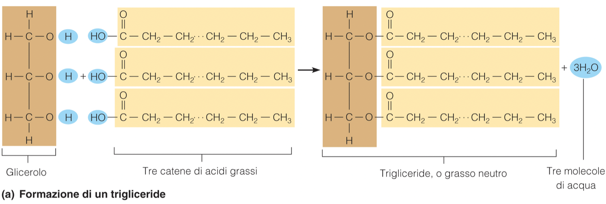
 

- **I fosfolipidi** caratterizzati da ==testa idrofila== contenente gruppo fosfato e   due code di acidi grassi (idrofobe). Da pensare come un trigliceride, solo che un acido grasso è sostituito da un fosfato
    > La membrana cellulare è costituita da un **doppio strato fosfolipidico**: le teste si orientano verso l'esterno e l'interno rispettivamente ("verso l'acqua"). di conseguenza le code stanno una contro l'altra
    
    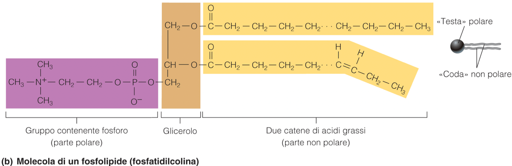
 

- **Gli steroidi**: Composti da uno scheletro di base composto da 4 anelli di carbonio (Colesterolo)
**Colesterolo** prodotto all'80% dal fegato. È precursore di ormoni sessuali, cortisolo e vitamina D.
**Cortisolo**: Ormone dello stress &rarr; ha effetto infiammatorio

    >In generale: gli **ormoni** sono messaggeri chimici nel sangue

    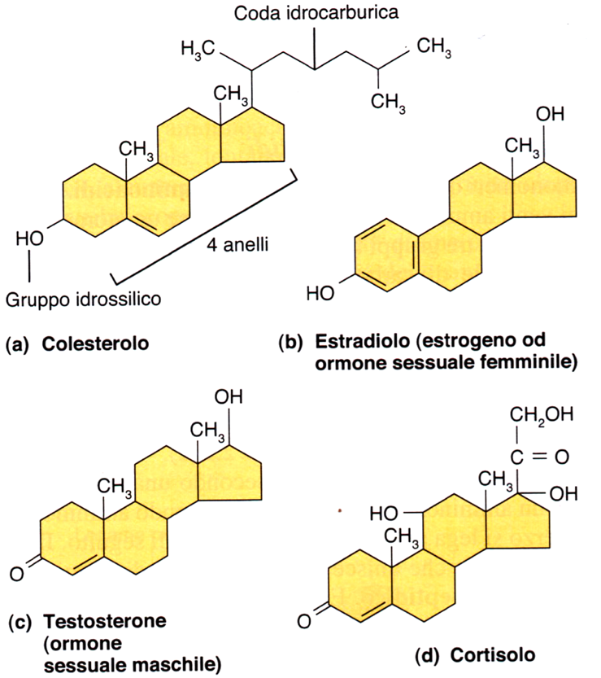

### LE PROTEINE
Sono polimeri, dove i monomeri sono gli amminoacidi (20 tipi)
Gli **amminoacidi** sono composti da un ==gruppo amminico==, un ==gruppo acido== e una ==catena laterale== (unica parte che cambia tra un aa e un altro).
- ==12 non essenziali==, ovvero prodotte dal nostro corpo
- ==8 essenziali==, da assumere con la dieta, dall'esterno
>Approfondimento: 
    - **Acido**: soluzione che contiene ioni liberi H+
    - **Base**: soluzione che contiene OH- 

Ogni proteina svolge la sua funzione grazie alla sua tridimensionalità
Funzioni delle proteine:
- **Proteine strutturali**: collagene (sostegno)
- **Proteine regolatrici**: ormoni (insulina,...)
- **Proteine di trasporto**: emoglobina (trasporta O2 nel sangue)
- **Proteine di difesa**: anticorpi
- **Proteine contrattili**: costituiscono le fibre dei muscoli
- **Enzimi**: catalizzatori di reazioni chimiche

    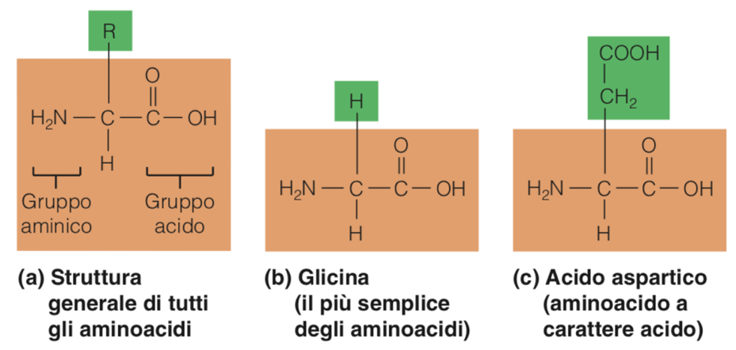
    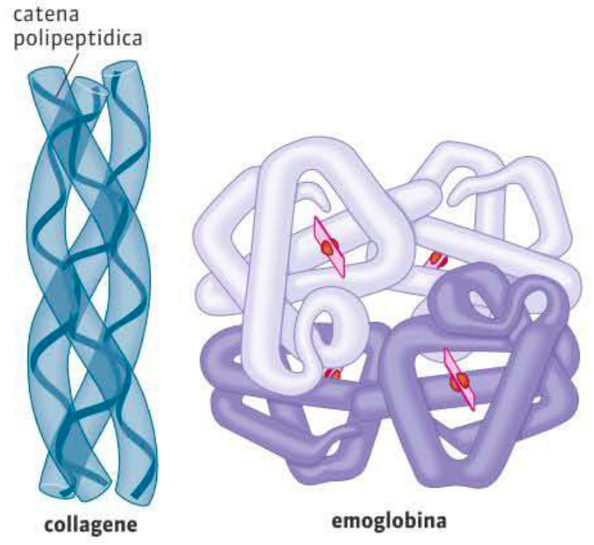

### GLI ZUCCHERI (carboidrati)
- **Monosaccaridi**: unità base degli zuccheri (monomero) &rarr; glucosio
- **Disaccardi**: formati da 2 monosaccaridi (glucosio + fruttosio &rarr;saccarosio)
- **Polisaccaridi**: formati da molti monosaccaridi. (amido, cellulosa, glicogeno). Fungono da riserva di energia

    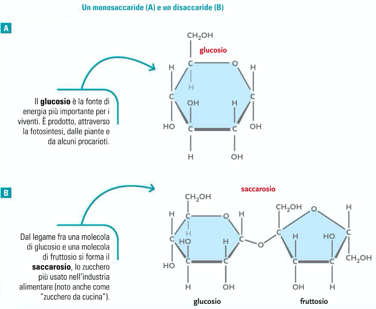
    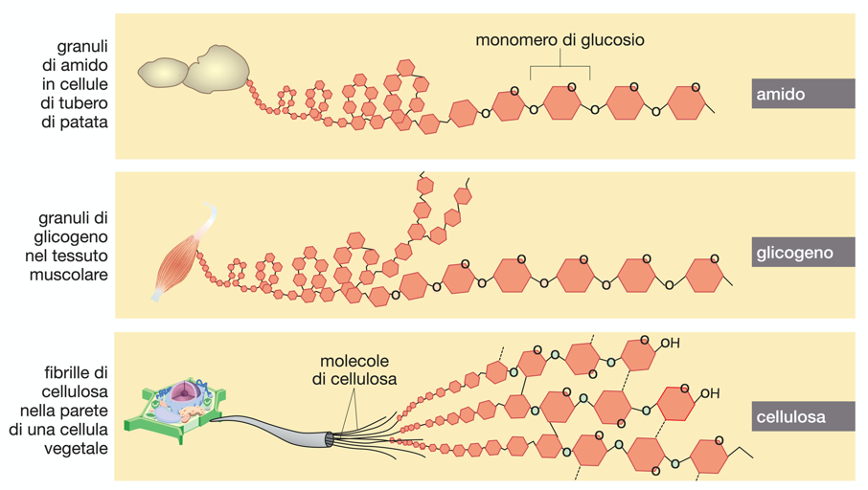

### GLI ACIDI NUCLEICI
**DNA** e **RNA** composti da **nucleotide** (monomero)

I nucleotidi sono formati da uno ==zucchero pentoso== (5 C), che lega un ==gruppo fosfato== e una ==base azotata==

- **DNA** (Acido desossiribonucleico): zucchero pentoso è desossiribosio, le basi azotate possono essere: Adenina (A), Citosina (C), Guanina (G), Timina(T).
==Unicamente a doppia elica==
    > In breve: A lega solo con T, C lega solo con G con legami idrogeno
- **RNA** (Acido ribonucleico): zucchero pentoso è ribosio, le basi possono essere: Adenina (A), Citosina (C), Guanina (G), Uracile (U).
==Principalmente a filamento singolo, eccezionalmente anche a doppia elica==

Gli acidi nucleici si occupano del flusso di informazioni genetiche
> DNA &rarr; RNA &rarr; proteine

 

    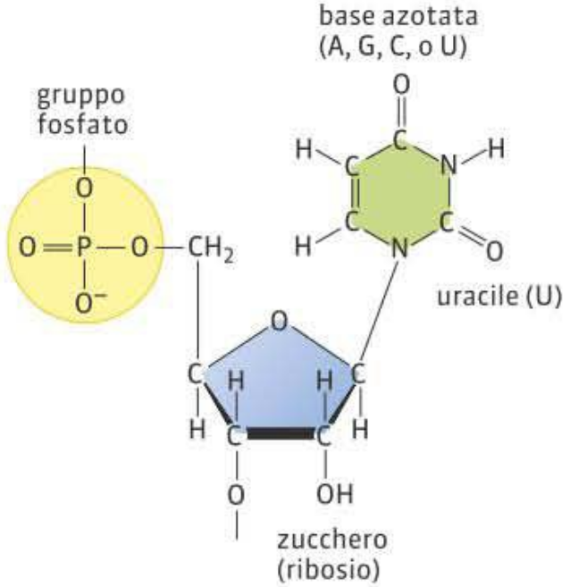
    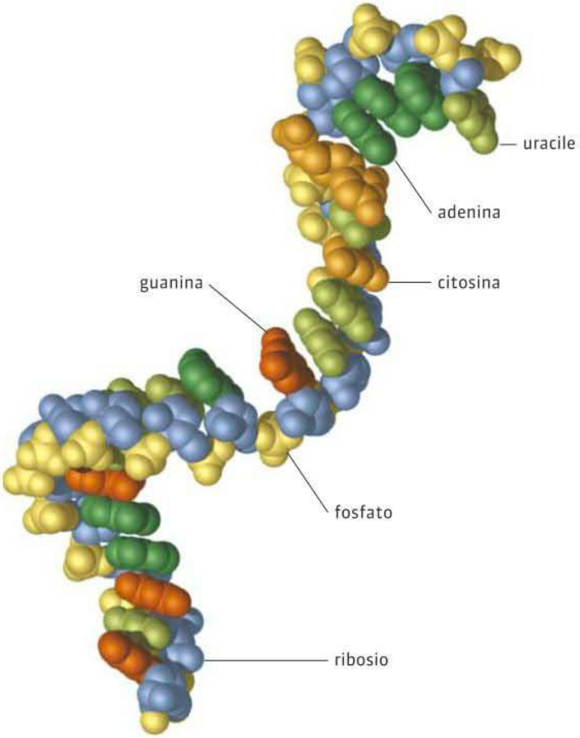

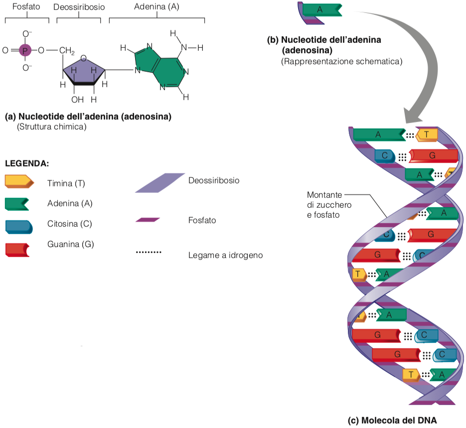

---

## LA MEMBRANA CELLULARE
Ha una **permeabilita selettiva**. Alcune molecole passano naturalmente, alcune hanno bisogno di canali di trasporto attivo o passivo, altre invece non passano del tutto

| Passa naturalmente | Bisogno di canali | Non passano |
| :--- | :--- | :--- |
| Piccole molecole polari (H~2~O, urea)  Molecole idrofobe apolari (O2, CO2), Ormoni steroidei | Glucosio, Ioni (Na+, K+, Cl−) | Grandi proteine, Polisaccaridi (es. amido), DNA |

 

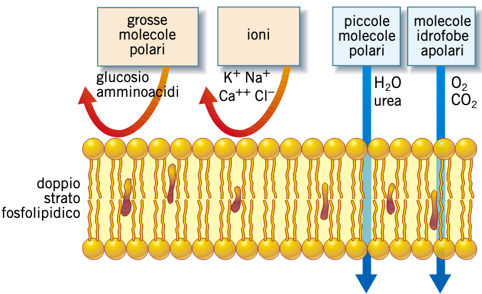

 

### I TRASPORTI CELLULARI
#### Trasporti passivi
Non necessitano energia, atomi e molecole si spostano semplicemente secondo gradiente di concentrazione ("da dove ce n'è di più a dove ce n'è di meno"). Si dice anche che tendono a un ==equilibrio dinamico==
Tipi di trasporti passivi:
- **Diffusione semplice**: Molecole che semplicemente attraversano la membrana
- **Diffusione facilitata**: Speciali proteine trans-membrana specifiche (ogni molecola ha la sua proteina corrispondente ==specifica==)
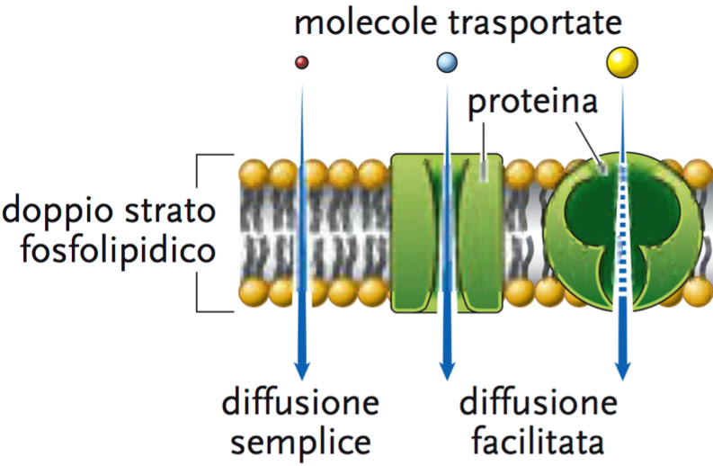

- **Osmosi**: Come visto sopra, le sostanze si muovono secondo gradiente di concentrazione. Quando però le molecole non possono attraversare la membrana (pensiamo a ioni carichi), allora l'==H~2~O si muove nella direzione opposta== per diluire il soluto (L'obbiettivo è sempre raggiungere l'equilibrio)

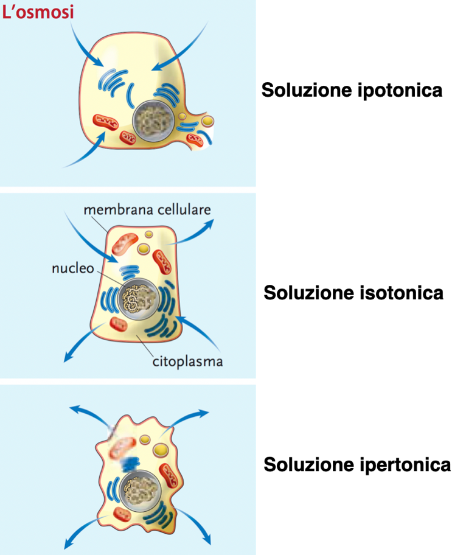
 

#### Energia nelle cellule
>**ATP**= **A**denosina-**T**ri**P**hosfato &rarr; Principalmente prodotta nel mitocondrio

ATP come scorta di energia chimica a rapido rilascio. Più nel dettaglio, quando ATP perde un gruppo fosfato rilascia energia. Per rigenerare ATP da ADP + gruppo fosfato, si usa energia (dal glucosio principalmente, ma anche da altre fonti) per ricreare ATP

> ATP &harr; ADP + P + Energia
#### Trasporti attivi
Richiede energia, solitamente spostamento ==contro gradiente==

##### La pompa Sodio (Na+) Potassio (K+)
Esempio di ==trasporto attivo== (detta anche Na+/K+ ATPasi)

Scopo: Mantenere il tono e volume cellulare (cosi che la cellula non esploda) &rarr; mantiene equilibrio osmotico e pressione
>Curiosità: serve anche nei neuroni e nelle cellule muscolari per mantenere il potenziale elettrico (cosi che rimangano eccitabili e possano trasmettere impulsi elettrici)

Ecco il funzionamento:
- Situazione di partenza: Alta concentrazione di K+ all'interno della cellula, mentre all'esterno bassa. Opposto invece per Na+, molto concentrato all'esterno della cellula, ma poco all'interno.
- Essendo ioni caricati non possono diffondere attraverso la membrana cellulare, percio avviene osmosi &rarr; tendenza a creare un equilibrio
- La pompa sodio/potassio sposta Na+ e K+ contro gradiente usando ATP (espelle 3 Na+ e "importa" 2 K+)

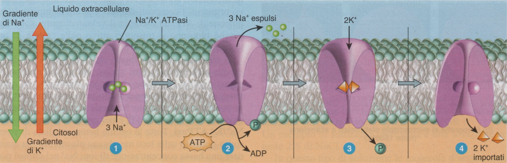

 

##### Eso/Endo-Citosi
Entrambi richiedono ustilizzo di energia per la creazione/distruzione della vescicola e per il trasporto della vescicola nella cellula
- **Esocitosi**: Vescicola interna alla cellula, composta da doppio strato fosfolipidico, contenente molecole molto grandi, si fonde con la membrana cellulare e rilascia all'esterno il contenuto
- **Endocitosi**: la membrana cellulare forma una fossetta in cui "ingloba" la macromolecola all'esterno, e va a formare una vescicola all'interno della cellula
    >Endocitosi si distingue in **fagocitosi** per materiale solido e **pinocitosi** per materiale liquido 

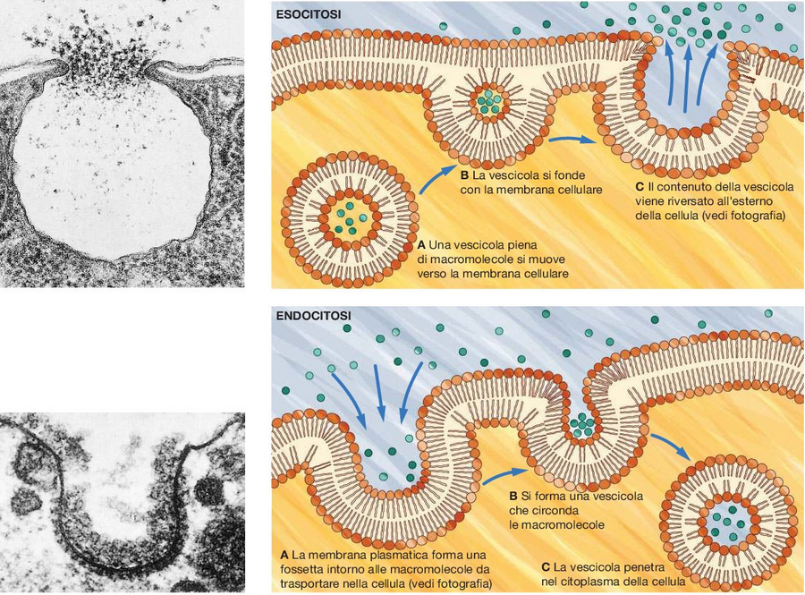
 
 ---

## LA CELLULA 
La più piccola unita dei viventi. Si dividono in **procarioti** ed **eucarioti** 

| Caratteristica | Cellula Procariote | Cellula Eucariote |
| :--- | :--- | :--- |
| **Nucleo** | Assente: il DNA si trova libero nel citoplasma in una zona chiamata **nucleoide**. Prensenta comunque **ribosomi** | Presente: il DNA è racchiuso nell'**involucro nucleare**. |
| **Dimensioni** | Più **piccola** (in genere **1 - 10 µm**). | Più **grande** (in genere **10 - 100 µm**). |
| **DNA** | Singolo cromosoma **circolare**; presenza di **plasmidi**. | Molteplici cromosomi **lineari** associati a **istoni**. |
| **Organelli con membrana** | **Assenti** | **Presenti** (mitocondri, cloroplasti, apparato di Golgi, RE). |
| **Parete cellulare** (Strato esterno alla membrana) | Sempre **presente** (fatta di **peptidoglicano** nei batteri). | Presente solo in **piante e funghi** (**cellulosa o chitina**). |
| **Riproduzione** | Principalmente **asessuata** tramite **scissione binaria**. | **Sia asessuata che sessuata** tramite **mitosi e meiosi**. |
| **Organismi** | Solo **unicellulari** (**Batteri e Archei**). | **Sia unicellulari che pluricellulari** (**Animali, Piante, Funghi, Protisti**). |

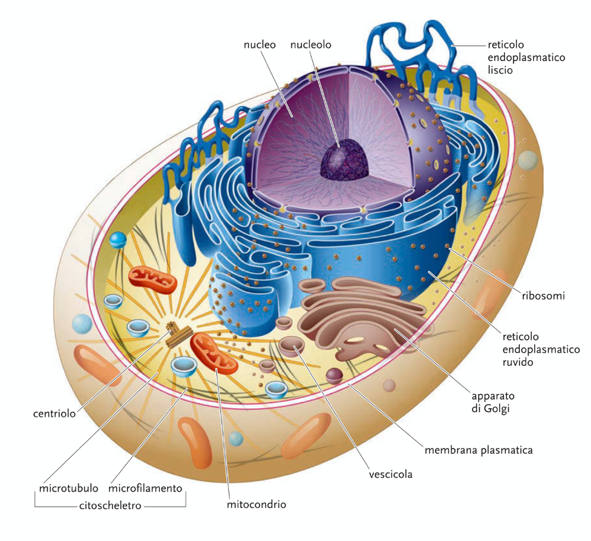

### GLI ORGANELLI
Di seguito elenco alcuni degli **organelli** presenti nelle cellule Eucariote
- **Nucleo**: contiene materiale genetico (DNA)
- **Ribosomi**: Macromolecole che traducono mRNA in proteine (essenziali per la sintesi proteica)
- **Reticolo Endoplasmatico**: insieme di membrane che ricoprono il nucleoide  
    - Reticolo Endoplasmatico **Rugoso (RER)**: rete di membrane coperta da ribosomi
    - Reticolo Endoplasmatico **Liscio (REL)**: privo di ribosomi, sintetizza lipidi e disintossica la cellula
- **Apparato di Golgi**: detto "il centro logistico" della cellula, modifica, impachetta e ditribuisce molecole in vescicole (dette **lisosomi** se contengono enzimi)
- **Mitocondio**: organello con membrana dove avviene respirazione cellulare

### LA RESPIRAZIONE CELLULARE
la respirazione cellulare è la produzione di ATP
Due strategie:
#### Respirazione cellulare **aerobica** (utilizza O2)
- Il processo inizia nel citoplasma (1.glicolisi)
- Il resto avviene nel mitocondrio (2.ciclo di Krebs + 3.fosforilazione ossidativa)
- reazione chimica complessiva della respiratione cellulare:
    >*C6H12O6 + 6 O2 &rarr; 6 CO2 + 6 H2O + 38 ATP*
- Nel cervello si usa solo glucosio per energia
- nel resto del corpo si usano anche grassi (trigliceridi) per produrre ATP
    >in breve: *Trigliceride &rarr; Acetyl-CoA*

Le tre tappe della respirazione cellulare aerobica:
1. Glicolisi: (avviene nel citoplasma):
    > In breve: *Glucosio &rarr; 2 Piruvato &rarr; acetyl-CoA*

    È una serie di reazioni chimiche che porta alla formazione di due molecole di **piruvato** (acido piruvico) a partire da una molecola di glucosio

    Serie di 10 reazioni:

    >*glucosio (6 C) &rarr; 2 piruvato (3 C ciascuno)*

    ==Reazione catabolita anaerobica==
    Produzione di 2 ATP
    Nel mitocondio il piruvato viene trasformato in **Acetyl-CoA** (Coenzima-A)
    >Coenzima-A: è un cofattore (molecola organica) che consente agli enzimi di svolgere efficacemtne la loro funzione
    
     

2. Ciclo di Krebs (nel mitocondrio)
    >In breve: 2 piruvato &rarr; Acetyl-CoA &rarr; 6 NADH 

    Il ciclo di Krebs è una serie di reazioni chimiche che consente all'organismo di produrre 2ATP
    È durante questa tappa che si forma CO2
    (NADH si occupa di trasportare gli elettroni)
 

3. Fosforilazione ossidativa (nel mitocondrio)
Si tratta di un trasporto di elettroni .
Durante questo processo si producono 34 ATP e H2O

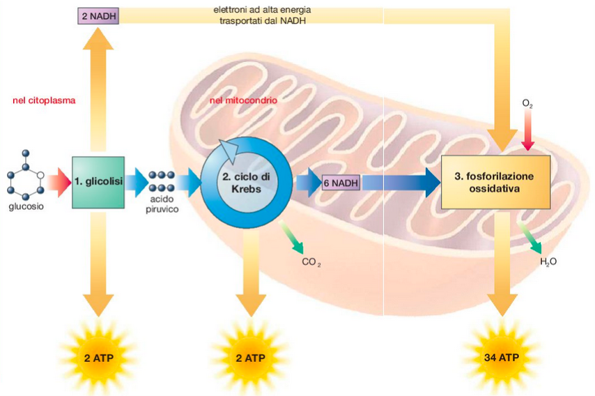

 

#### Respirazione cellulare **anaerobica** (senza O2)
Esempio: i globuli rossi non possiedono mitocondri, ma devono comunque produrre ATP

- metabolismo anaerobico **lattacido**
    Produce solo 2 molecole di ATP
    Avviene in 2 tappe (==interamente nel citoplasma==):
    1. Glicolisi (come respirazione aerobica)
        Produzione di  2 ATP
        > In breve: *Glucosio &rarr; 2 Piruvato*

    2. Fermentazione lattica
        > in breve: *Piruvato &rarr; Lattato*

    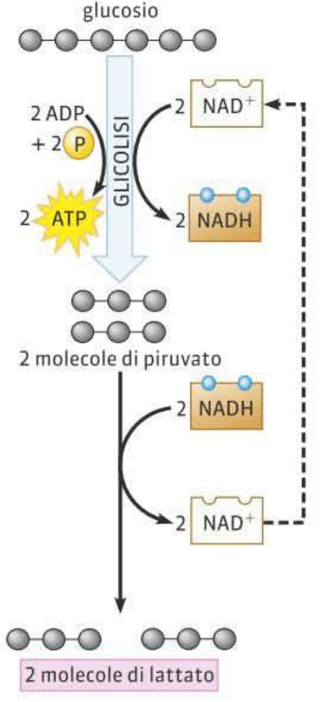
- metabolismo anaerobico **alattacido**
    Viene chiamato  Sistema creatinfosfato (CP)
    Si tratta di un tipo di respirazione cellulare anaerobica dove **NON** viene prodotto acido lattico
    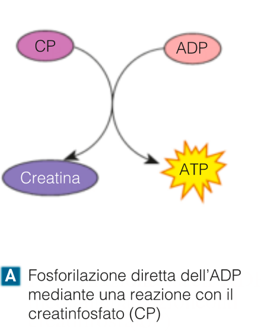
    Sistema utilizzato principalmente dai muscoli
    Chiamato così perche partecipa alla reazione una molecola di creatina con attaccato un fosfato (CP)
    >in breve: fosfato di CP viene trasferito a un ADP &rarr; si crea una molecola di creatina e una di ATP
    

    Più creatina è presente nei muscoli, piu CP viene formato nel muscolo. 
    Meccanismo rapidissimo

## L'ORGANIZZAZIONE GERARCHICA DEL CORPO UMANO
### DA ATOMI A ORGANISMO
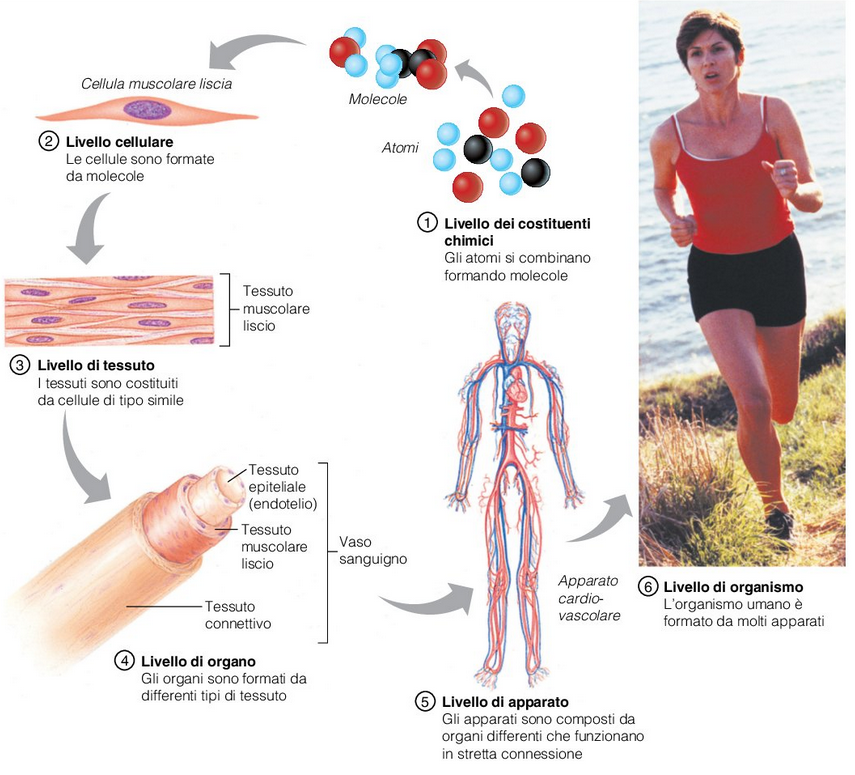

>Diversi livelli di organizzazione:
Atomi &rarr; molecole &rarr; cellule &rarr; tessuti &rarr; organi &rarr; apparati (o sistemi) &rarr; organismo

Alcuni dettagli:
- un organo è formato da ==due o più tessuti==
- un organo ha una o più funzioni
- più organi vanno a formare un sistema/apparato

### CORRELAZIONE TRA SISTEMI

**Gi apparati non funzionano come entità separate**, ma cooperano tra di loro

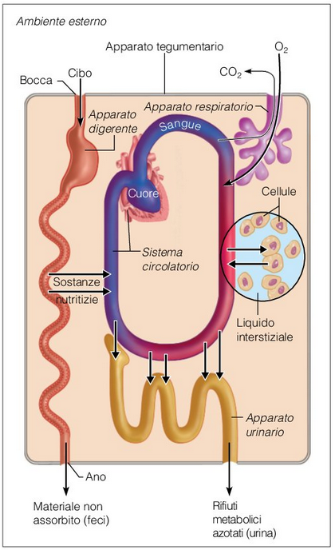

- Nell'apparato digerente avvengono reazioni cataboliche (es. idrolisi)
- Tra cellule e sangue avvengono scambi di glucosio, O2 (esce dal sangue ed entra nelle cellule), mentre CO2 e rifiuti azotati (prodotti del metabolismo delle proteine).
- I rifiuti azotati sono tossici (causano la morte delle cellule) e vanno rimossi. Entrano nel sangue e poi smaltiti dall'apparato escretore (dai reni)

#### CO2 nell'organismo
Perche il corpo deve espellere immediatamente CO2? Perche ==acidifica il sangue==
CO2 + H~2~O &rarr; H2CO3(acido carbonico) &rarr; HCO3−(ione carbonato) + H+
Se la concentrazione di CO2 è troppo alta le proteine si denaturano (perdono la loro tridimensionalità)

CO2 serve comunque come regolatore di vasodilatazione nel cervello

### I TESSUTI DEL CORPO UMANO
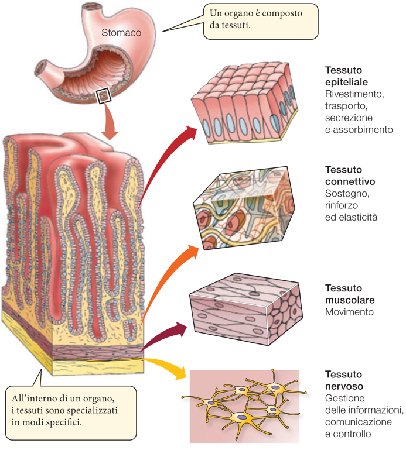

In questo esempio vediamo come lo stomaco è composto da diversi tipi di tessuti

#### Il tessuto epiteliale
Tessuto epiteliale composto da cellule adagiate su una ==membrana basale==
**Membrana basale**: in parte prodotta da cellule del tessuto epiteliale e in parte da cellule del tessuto connettivo
> Nell'immagine sopra, dettaglio del tessuto epiteliale: la membrana basale è indicata in giallo 

Il tessuto epiteliale è **avascolare**: sproffisto di vasi sanguigni. Il sostentamento delle cellule epiteliali è dato dal tessuto connettivo su cui è adagiato

I tessuti epiteliali si rinnovano molto rapidamente (cellule morte vengono sostituite velocemente da cellule nuove)

Classificazione:
- Tessuto epiteliale di **rivestimento**
    Si presenta in due forme:
    - epitelio **semplice**: singolo strato di cellule, funzione di ==assorbimento==. Lo troviamo come rivestimento del tubo digerente.
        >Diffusione semplice è efficace su brevi distanze, percio il singolo strato è adatto alle mucose digerenti (o in generale per tessuti che necessitano la funzione di diffusione semplice)

    - epitelio **stratificato**: più strati di cellule &rarr; solo uno strato è a contatto con  la membrana basale.
    Funzione ==protettiva==
- Tessuto epiteliale **ghiandolare**
    Forma la porzione della **ghiandola** che secerne (produzione e liberazione) il contenuto specifico 
    Le ghiandole che si trovano nel nostro corpo sono classificate in ==tre categorie==:
    1. Ghiandole **endocrine** (es.tiroide): versano il contenuto direttamente nel sangue. Nello specifico le molecole prodotte e riversate nel sangue da queste ghiandole si chiamano **ormoni** 
    2. Ghiandole **esocrine** (es. ghiandole sudoripare): riversano il contenuto fuori dal corpo, oppure all'interno di una sua cavità (es nel tubo digerente)
    3. Ghiandole **miste** (es. pancreas): hanno capacita sia endocrine che esocrine
        > ~99% del pancreas è esocrino &rarr; produce succo pancreatico (cocktail di enzimi)
        ~1% endocrino (Isole di Langherans) &rarr; produce due ormoni (insulina e glucagone) per la regolazione di glucosio nel sangue 

#### Il tessuto connettivo

In generale, con il termine **tessuto connettivo**, si intende:
==cellule immerse in una matrice extracellulare==, la cui composizione chimica varia da tessuto a tessuto (in base alla funzione)

La **matrice cellulare** è prodotta dalle cellule del tessuto connettivo stesso, e può essere liquida, solida o gelatinosa

#### Le membrane epiteliali e connettivali
Le **membrane epiteliali** sono membrane costituite da epitelio e un sottile strato di tessuto connettivo sottostante
Si dividono in tre tipi:
1. Membrane **mucose**(o semplicemente **mucose**)
    Rivestono ==le cavità del corpo== che comunicano direttamente con l'esterno &rarr; costantemente umide perche bagnate da **secreti**
    >Esempi: 
        - L'esofago è ricoperto da una mucosa stratificata &rarr; durante il passaggio del bolo alimentare, molte cellule della mucosa vengono portate via. I numerosi strati servono per proteggere da danni all'esofago
        - Nell'intestino la mucosa invece è composta da strato epiteliale semplice &rarr; funzione di assorbimento dell'intestino favorita dal singolo strato 
    In generale: a dipendenza della mucosa troviamo ==diverse strutture in base alla  diverse funzioni==

2. Membrane **sierose**(o solamente **sierose**)
    Riveste le cavità del corpo che non comunicano direttamente con l'estero
    Ogni membrana sierosa è costituita da due foglietti
    - **Foglietto viscerale**: foglietto direttamente a contatto con l'organo (==riveste l'organo==)
    - **Foglietto parietale**: ==riveste la parete== della cavità che ospita l'organo in questione
    
    lo spazio tra i due foglietti è rimepito da un liquido lubrificante (prodotto dai due foglietti)
    
    >Possiediamo **3 membrane sierose** (tutte possiedeno foglietto parietale e viscerale):
        1. Pleura (riveste i polmoni)
        2. Pericardio (riveste il cuore)
        3. Peritoneo (riveste organi della cavità addominale, tranne i reni, che venono chiamati *retroperineali*) &rarr; membrana sierosa più grande
    
3. Membrane **cutanee** (o semplicemente cute, pelle):
    Strato esterno, funzione di protezione

4. **Membrane connettivali**: costituite unicamente da ==tessuto connettivo==
>Esempio: **Membrana sioviale**: composta solo da tessuto connettivo, e localizzata nelle aritcolazioni sinoviali (articolazioni mobili)

#### Il tessuto muscolare

#### Il tessuto nervoso

# L'EQUILIBRIO OMEOSTATICO

È il ==mantenimento costante del proprio ambiente interno== anche in presenza di perturbazioni che provengono sia dall'ambiente interno che da quello esterno &rarr; statto di ==**equilibrio dinamico**==

L'omeostasi non è un concetto statico e immutabile, bensì un continuo reagire ed attatarsi agli stimoli

>Esempio: la temperatura interna degli umani è di ~37oC. Subirà variazioni in base a stimoli interni ed esterni &rarr; rappresentiamo quindi la temperatura come intervallo &rarr; so che finchè la mia temperatura è all'interno dell'intervallo l'omoestasi è mantenuta

In generale si parla di **parametri** (o **variabili**) **fisiologici**, sempre rappresentati da intervalli e ==regolati in maniera precisa== (es. temperatura, concentrazione di glucosio nel sangue, frequenza cardiaca, pressione sanguigna)

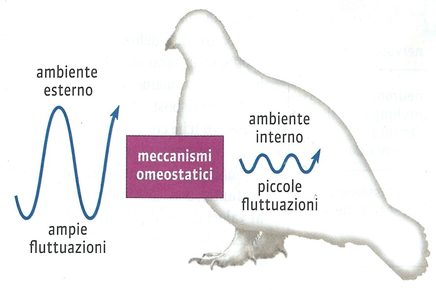

L'omeostasi è mantenuta attraverso **meccanismi** (o **sistemi**) **di controllo omesotatico**

## SISTEMI DI CONTROLLO OMEOSTATICI

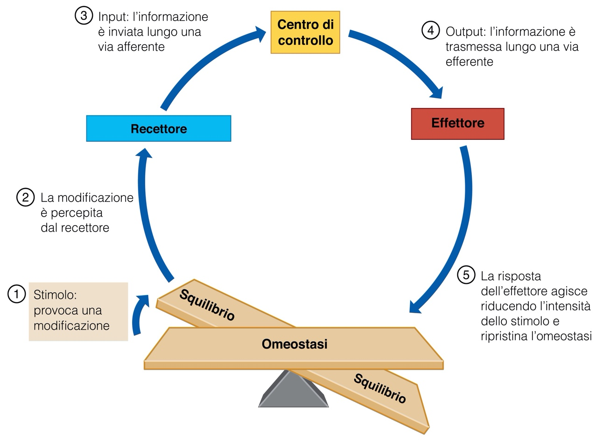

Commenti all'immagine:

1. **Stimolo**: ==variazione==/alterazione di una variabile fisiologica (vaolre può aumentare o diminuire)

2. Il **recettore** è un sensore che ==misura il valore== di una variabile fisiologica ben specifica (i recettori sono specifici alla variabile fisiologica), e si accorge dello stimolo (modifica di variabile fisiologica)

3. Il **centro di controllo** è come un "computer" dove sono registrati i valori di ==tutte== le variabili fisiologiche
Stimolo misurato dal recettore &rarr; segnale inviato al **centro di controllo** &rarr; valore inviato dal centro di controllo confrontato con il valore standard/intervallo della variabile in questione
==2 tipi di risposte==:

    1. Se il valore riportato è all'interno del range fisiologico, nessuna azion necessaria
    2. Se il valore è fuori range, ==azione necessaria== (poichè omeostasi non è mantenuta) &rarr; il centro di controllo ==DEVE ELABORARE UNA RISPOSTA== per ripristinare l'omeostasi
4. **Effettore** (solitamente o muscolo o ghiandola): riceve precise istruzioni dal centro di controllo per agire e ripristinare l'omeostasi

- **Via afferente** (riporta stimolo rilevato da recettore): puo essere via **nervosa** o via **ormonale**. Nella maggior parte dei casi si tratta di una via nervosa
- **Via ennerente** (riporta la risposta del centro di controllo all'effettore): come prima, puo essere via **nervosa** o **ormonale**

L'omeostasi è mantenuta attraverso dai meccanismi di controllo omeostatico: 
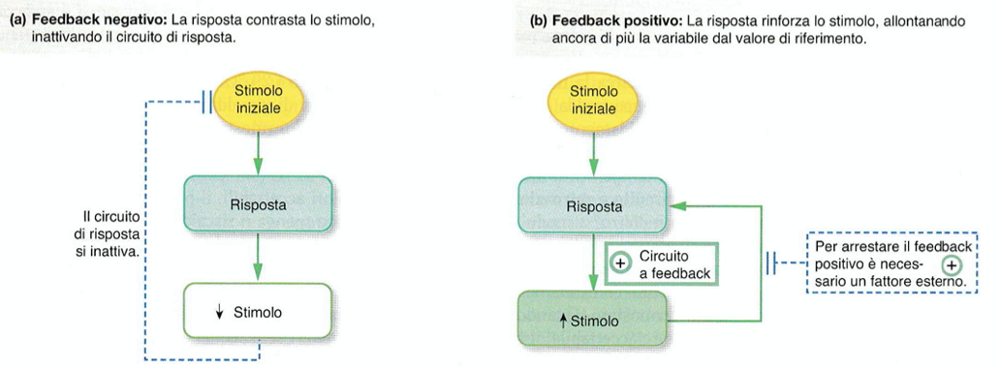
- **Feedback negativo** (meccanismo di retroazione negativa): La quasi totalità dell'omeostasi è regolata attraverso meccanismi a feedback negativo
La risposta si ==oppone== allo stimolo iniziale

    >In breve:
        - Valore è alto &rarr; feedback negativo lo fa scendere
        - Valore è basso &rarr; feedback negativo lo fa alzare

- **Feedback positivo** (meccanismo di retroazione positiva): La risposta ==rinforza== lo stimolo, allontanado la variabile ancora di più dal valore di riferimento, finche un fattore esterno (fattore d'arresto) termina il ciclo di feedback positivo
    > Esempio: nel parto, le contrazioni sono regolate da un feedback positivo &rarr; contrazioni sempre più frequenti finche il figlio nasce (fattore esterno)

## TIPI DI RECETTORI
Possono essere o ==neuroni== o ==cellule specializzate==
I **recettori** sono in grado di rilevare diverse forme di energia
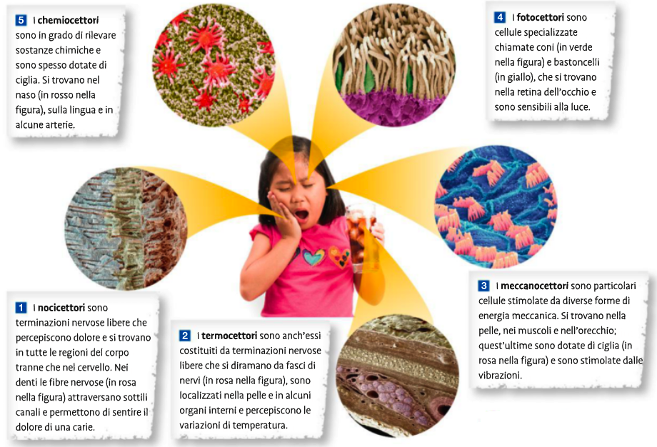

1. **Nocicettori**: terminazioni nervose libere. Definiti come i ==recettori del dolore==. Misurano valori estremi delle altre forme di energia.
    > Antidolorifici vanno ad agire direttamente sul noccicettore, impedendo di mandare il segnale al cervello

2. **Termorecettori**: in grado di misurare ==energia termica==

3. **Meccanorecettori**: in grado di misurare ==energia meccanica==

4. **Fotocettori**: misurano ==energia luminosa==

5. **Chemiocettori** misurano ==energia chimica==

## I CENTRI DI CONTROLLO

### Il sistema nervoso come centro di controllo

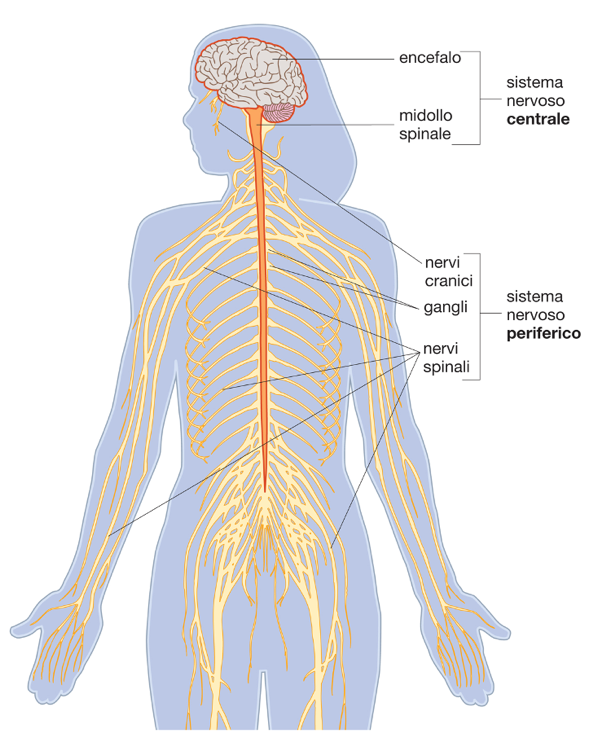

- **Sistema nervoso centrale**: formato da encefalo e midollo spinale
- **Sistema nervoso periferico**: composto da nervi e gangli.
    I **nervi** sono composti da fasci di assoni.
    Si dividono in:
    - Nervi **spinali**: nascono dal ==midollo spinale==. Abbiamo 31 paia (62 totali) nervi spinali
    - Nervi **cranici**: nascono dall'==encefalo==. Abbiamo 12 paia (24 totali)

Sia che facciamo riferimento al sistema nervoso centralo o periferico, la cellula base è il neurone

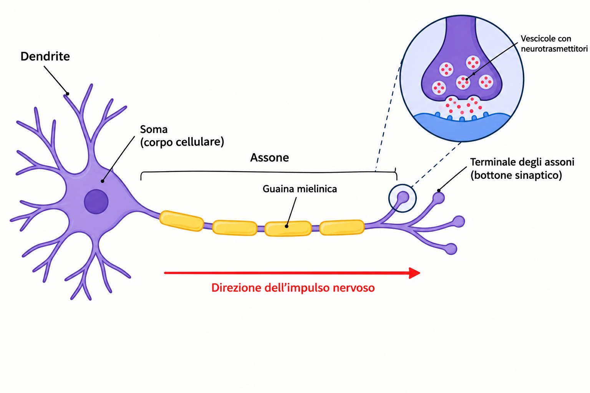

Commenti sull'immagine: 
- **Dendrite**: breve prolungamento del neurone che trasporta ==informazioni al corpo cellulare== 
- **Soma** (o **corpo cellulare**): regione del neurone che contiene il nucleo e altri organelli con membrana
- **Assone**: prolungamento più lungo del neurone. È in grado di generare e trasportare un ==impulso nervoso==. L'impulso è generato nel corpo cellulare e viene trasmesso lungo l'assone fino ai terminali dell'assone
    > Concetto del tutto o nulla. Se una determinata soglia di potenziale elettrico viene raggiunta, allora l'assone genera e trasporta l'impulso nervoso, altrimenti non genera nulla
- **Terminale degli assoni** (o **bottone sinaptico**): Rigonfiamento terminale dell'assone. Contiene ==vescicole con neurotrasmettitori== 
- **Guaine mieliniche**: Rivestimento lipidico prodotto dalle cellule di Schwann (nel SNP)
 

- **SNP**: composto da
    - motoneuroni: corpo cellulare all'interno del midollo spinale. Trasferisce informazioni dal SNC alla periferia del corpo
    - neuroni sensoriali: corpo cellulare all'interno dei gangli. Trasferisce informazioni dalla periferia al SNC
    - Ganglio: è un rigonfiamento della radice dorsale che contiene i corpi cellulari dei neuroni sensoriali. 

- **SNC**: interneuroni: ubicato o nel midollo spinale o nell'encefalo. Posizionato tra un neurone sensoriale e un motoneurone (non sempre così).

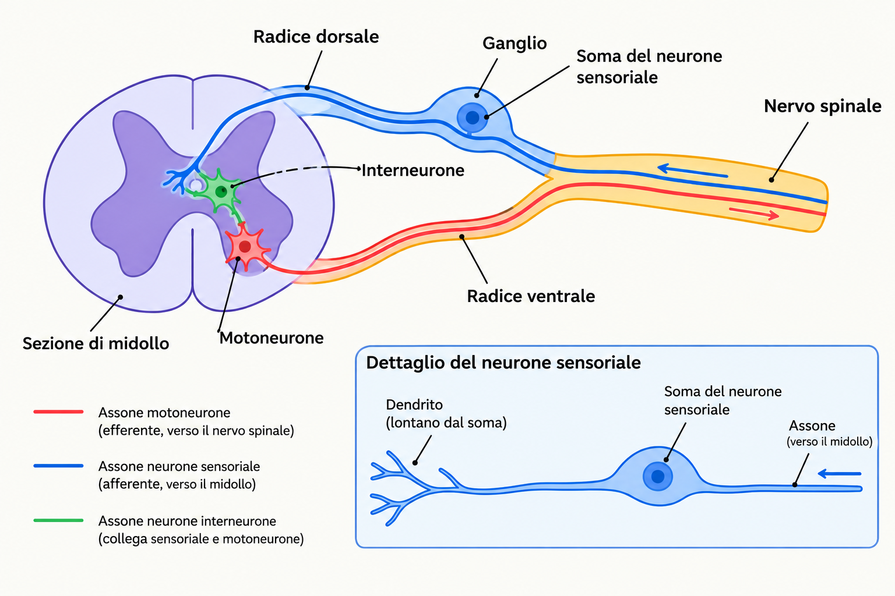

>In breve: Meccanismo del riflesso &rarr; informazione rilevata arriva da neurone sensoriale, interneurone trasferisce l'info al motoneurone, che manda l'info al muscolo di muoversi. Non passa dall'encefalo. Informazione viene trasferita ed elaborata molto più velocemente con questo **circuito**, rispetto a quando l'info viene processata dall'encefalo

### Il sistema ormononale come centro di controllo

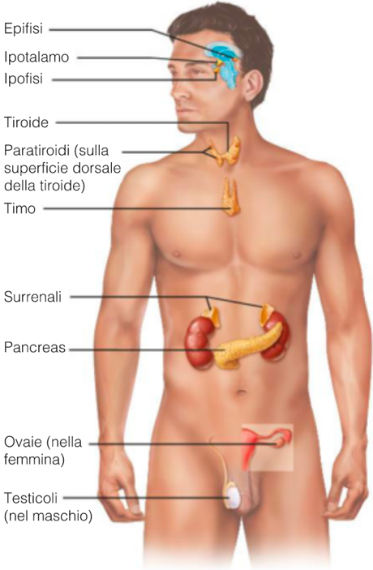

Sistema costituito da ghiandole endocrine (tessuto epiteliale ghiandolare) che rilasciano **ormoni**

La maggior parte delle ghiandole endocrine sono controllate dall'asse **ipotalamo-ipofisi**

- L'**ipotalamo** è una regione dell'encefalo che svolge funzioni fondamentali che consentono il mantenimento dell'omeostasi. L'ipotalamo produce diversi ormoni che servono a regolare l'attività dell'ipofisi

- L'**ipofisi** è una piccola ghiandola endocrina posta alla base del capo. È suddivisa in due regioni:
    - **Neuroipofisi** (posteriore): prolungamento dell'ipotalamo, non produce ormoni propri. Funge da "magazzino" due ormoni prodotti dall'ipotalamo, ovvero **ossitocina** e **ADH** (detto anche vasopressina, ormone antidiuretico).
    - **Adenoipofisi** (anteriore): produce ormoni propri, sotto regolazione dell'ipotalamo

## LA REGOLAZIONE DELLA GLICEMIA (feedback negativo)

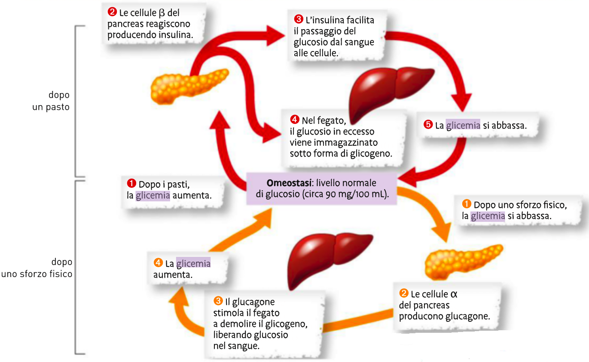

**Glicemia**: concentrazione di glucosio nel sangue

### Iperglicemia
1. **Iperglicemia**: dopo un pasto la concentrazione di glucosio nel sangue è aumentato
2. **Cellule &beta;** del pancreas "leggono" questo valore iperglicemico e producono **insulina**
3. L'insulina si lega alla membrana delle cellule. La cellula risponde trasportando la proteina di trasporto del glucosio sulla membrana &rarr; glucosio entra nelle cellule. 
Questo meccanismo non avviene nel fegato
4. L'insulina agisce anche sul fegato che produce glicogeno con il glucosio in glicogeno
5. il meccanismo 3 e 4 fanno ==diminuire il glucosio nel sangue &rarr; glicemia diminuisce.==

### Ipoglicemia
Avviene durante o dopo uno sforzo fisico
1. **Ipoglicemia**: poco glucosio nel sangue
2. Cellule &alpha; nel pancreas leggono questo cambiamento e producono **glucagone**.
3. Il glucagone stimola il fegato a scindere glicogeno, liberando glucosio nel sangue
4. ==Glicemia aumenta== e ritorna a valore omeostatico

### Il diabete mellito
Il **diabete mellito** è un disturbo cronico caratterizzato da un'alta concentrazione di zuccheri nel sangue. Iperglicemia perenne

|                    |Diabete di tipo 1 |Diabete di tipo 2|
|-|-|-|
|Percentuale dei casi|~10%              |~90%             |
|Chi colpisce        |Individui molto giovani| Si manifesta in persone a partire dai ~40 anni. L'età si sta abbassando sempre di più|
|Come si sviluppa|È una malattia autoimmune. Cellule &beta; distrutte completamente| In questa forma di diabete si assiste ad una forma di riduzione dell'azione dell'insulina (a livello della cellula) &rarr; Si parla perciò di **insulino-resistenza**. Insulina non più efficace a far assorbire glucosio dalle cellule|
|Altro|Si definisce **insulino-dipendente** &rarr; la persona non può produrre insulina| Si definisce quindi **insulino-indipendente** &rarr; la persona può produrre insulina|
|Terapia|Erogatore di insulina|**Dieta** + cura farmacologica (metformina: riduce produzione epatica di glucosio e aumenta la sensibilità insulinica) |

#### Il diabete mellito di tipo II
- Legato alla ==presenza eccessiva di trigliceridi==
- Ormoni proteici (come insulina) non posso attraversare il doppio strato fosfolipidico. Sulla cellula bersaglio (sulla membrana) ci sarà quindi un recettore specifico per l'insulina. 
- L'insulina va a legarsi al recettore, ed avviene una risposta all'interno della cellula
- Quando le zone di deposito dei trigliceridi (sottocutanee, ventrale), allora le cellule si riempiono a loro volta di trigliceridi
- I trigliceridi inibiscono la risposta insulinica
    In che modo?
    - la cellula contiene vescicole contenenti proteine canali per glucosio
    - In situazioni normali la risposta insulinica fa si che queste proteine canale vengano trasportate sulla membrana
    - L'alta presenza di trigliceridi blocca/inibisce (┤) proprio questo trasporto di proteine canale 

## IL PARTO (feedback positivo)

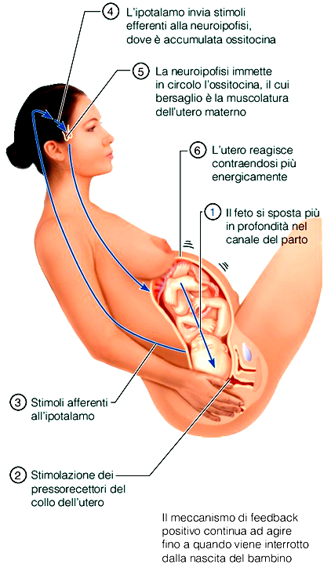

Stimolo che viene amplificato sempre di più, fino all'arrivo del fattore esterno
1. Il feto è pronto per nascere, e si sposta in profondità. 
2. La testa spinge verso la parete dell'utero (presenza di pressorecettori che rilevano la pressione/movimento).
3. Stimoli afferenti traferiti all'ipotalamo
4. A sua volta l'ipotalamo segnala alla neuroipofisi (che non produce ormoni proprio).
5. Neuroipofisi mette in circolo ossitocina (prodotta dall'ipotalamo), il cui bersaglio è la muscolatura dell'utero mterno
6. L'utero reagisce contraendosi più intensamente
7. Il feto si sposta più verso il basso, dando ulteriori segnali di feedback  &rarr; notiamo un progressivo accumulo di ossitocina in circolo, che stimola contrazioni sempre più forti

Una volta che il feto nasce, questo *fattore esterno* interrompe il ciclo di feedback positivo

Alcuni commenti:
- la muscolatura dell'utero è muscolatura liscia, ovvero involontaria

# L'APPARATO RESPIRATORIO
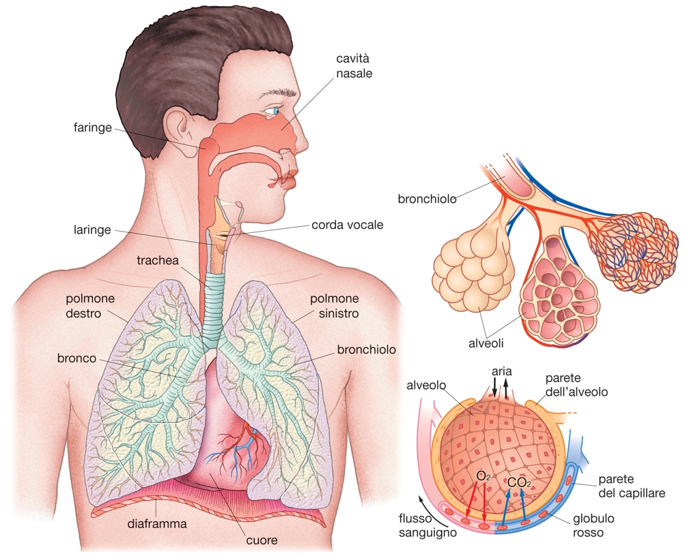

Funzioni:
- Scambi di gas (immettere O2 ed emettere CO2)
- Percezione degli odori (tramite **epitelio olfattivo**)
- Regolazione del pH del sangue (a breve termine)
- Emissione di suoni 

## Anatomia dell'apparato
- Vie aeree **superiori**:
    - **naso**
    - **faringe**: canale condiviso tra apparato respiratorio e digerente. È un canale che si divide ulteriormente in tre semgenti (dall'alto verso il basso): nasofaringe (comunica con la cavità nasale) &rarr; orofaringe (regione che comunica con la cavità orale) &rarr; laringofaringe (comunica con la laringe) 
- Vie aeree **inferiori**:
    - **laringe** 
    - **trachea**
    - **bronchi** 
    - **bronchioli**
    - **Polmoni**: polmone destro, sinistro e alveoli

## Percorso dell'aria in entrata/uscita

Vie di conduzione dell'aria:

Punti evidenziati rappresentano i punti specifici dove la mucosa respiratoria è presente

- cavità ==nasale==/orale (se l'aria entra dalla cavità orale, non passa dalla mucosa nasale, perdendo parzialmente l'effetto purificatore)
- faringe (naso/oro/laringo -faringe)
- ==laringe==
- ==trachea==
- ==bronchi== (destro e sinistro)
- bronchioli
- alveoli: unità funzionali dell'apparato respiratorio. È qui che avvengono gli scambi di gas &rarr; avvengono per &Delta;p

Avvengono 3 processi importanti nelle vie di conduzione
- Riscaldata
- Umidificata (O2 in aria secca irrita le mucose)
- Purificata

## La mucosa respiratoria

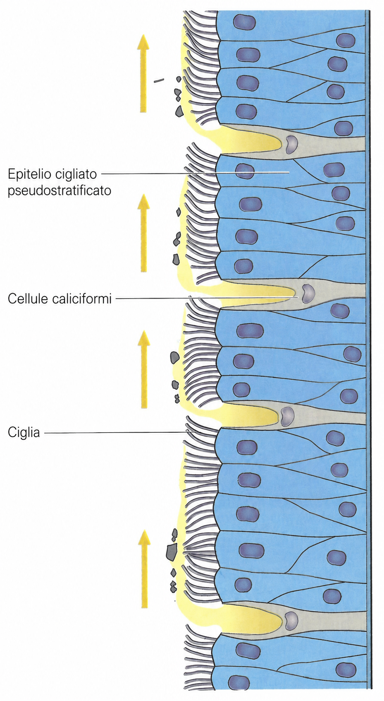

- Parliamo di **epitelio pseudostratificato** perche al microscopio sembra composto da piu strati, ma in realta è a singolo strato, ma con nuclei posizionati nella cellula in posizioni differenti
- Tra le cellule epiteliali pseudostratificate troviamo **cellule caliciformi**, che producono muco
- Il **muco** è una sostanza viscosa che svolge due funzioni:
        1. lubrifica le ciglia
        2. serve a intrappolare sostanze nocive e agenti patogeni

Il movimento delle ciglia sposta il muco verso l'alto
Il fumo inibisce il movimento delle ciglia

