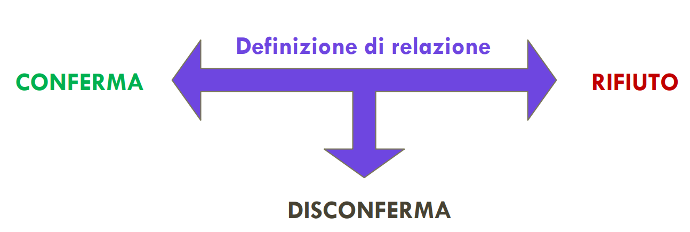

[TOC]

---

## LA COMUNICAZIONE UMANA COME SISTEMA DI COMUNICAZIONE

### Cos'è un sistema?

Dal greco *syn + histanai* (mettere insieme)
Esempio delle volpi e conigli: per studiare le volpi bisogna necessariamente i conigli e viceversa.
Il sistema si eterodetermina: il sistema si regola in base al rapporto tra gli elementi

Il modello circolare sottende la supremazia dell'inter-relazione

### Una definizione

Un ==sistema== è un insieme di **elementi** che interagiscono in una **rete** di relazioni, in cui ciascun elementi ha una **funzione** e vi sono delle **regole** precise che lo regolano.
qualsiasi **cambiamento** che avviene nel sistema porta ad una modifica dello stesso, volti a ricercare l'**omeostasi**

### Sistemi aperti

- Gli **organismi viventi** sono dei sistemi aperti
- Per sopravvivere hanno bisogno di alimentarsi con un **flusso di energia** e di **materia** dal loro **ambiente**
- ciò ne determina il **continuo cambiamento**, così come la tendenza ad uno stato di ==**equilibrio dinamico**==

Attraverso un processo di **autoregolazione** il sistema tende alla propria conservazione

### Pattern e network

I sistemi non si qualificano ma vanno mappati

Possiamo rappresentare schematicamente un sistema come una rete con alcuni nodi

### Superamento della logica lineare

> A &rarr; B: frammenta e semplifica la complessità della realtà e non tiene sufficientemente conto di ==variabili== e ==contesto==

Fornice realta **semplificate**, non descrizioni esaustive

### Linearità vs Circolarità

- **Nel modello lineare** le cause sono antecedenti all'effetto
L'influenza precede sempre in una direzione
Limite: gli effetti producono la causa, ma non esistono cause separate dagli effetti
- **Nel modello circolare** le cause sono inseparabili dagli effetti. impossibile stabilire un punto di inizio: tutto influenza tutto, e procede secondo un continuo flusso di autoinfluenzamento

### Autoregolazione, feedback e regole

- Spesso autoregolazione arriva da regole descrittive (descrive fenomeno standard ricorrente)
- Queste regole descrittive servono al sistema per autoregolarsi ed evitare spreco di energie. 
- Es: posti in aula rimangono quasi sempre gli stessi. Il gruppo classe perde meno energie ogni giorno per scegliere i posti

### Feedback loop

È una **struttura circolare** di elementi connessi **Causalmente** in cui una causa iniziale si propaga lungo le connsessioni del circuito, così che ognuni input ha un effetto sul successivo, fino a che l'ultimo elemento ha l'effetto sul primo elemento del ciclo.
La prima connessione risulta essere influenzata dall'ultima e ciò produce **autoregolazione** del sistema

### L'omeostasi: Un equilibrio Dinamico

I sistemi tendono al mmantenimento di un certo equilibrio attraverso la stabilizzazione di regole, comportamenti ricorrenti e schemi standard &rarr; **Pattern**

- Feedback Positivo
- Feedback Negativo

==Troppa tendenza alla trasformazione o alla staticità metterebbe il sistema a rischio==

### Caratteristiche dei sistemi

- **Il principio di totalità**
    >L'uno influenza il tutto, come un domino
- **Il principio di non-sommatività**
    > Il sistema è piu della somma delle sue parti

    L'analisi delle singole componenti non riuscirebbe a spiegare tutto il sistema, poichè si tratta di proprietà integrate.
    Le proprietà di un sistema vengono distrutte quando un sistema viene dissezionato, fisicamente o concettualmente, in elementi isolati
- **Il principio di equifinalità**
    >Stesse cause non producono stessi esiti

    >Stessi esiti possono derivare da diverse condizioni di partenza

## I 5 ASSIOMI DELLA COMUNICAZIONE

### 1o assioma

>È impossibile non comunicare, in quanto è impossibile adottare un non-comportamento

Cercheremo sempre di interpretare una comunicazione, anche se non presente
Ciò è dato anche da diversi elementi relazionali del sistema (aspettative, preconcetti, ecc...)

### 2o assioma

>In ogni messaggio c'è un livello di **contenuto** e uno di **relazione**

- **Contenuto**: il messaggio più evidente, "ciò che viene detto"
- **Relazione**: quasi sempre sottinteso, relegato agli aspetti non verbali (postura, tempo, tono). Il livello di relazione sotteso viene anche definito **meta-comunicazione**, e può essere implicita o esplicita (nel caso in cui descrivo a parole precise e specifiche della nostra relazione)

Spesso il messaggio relazionale non viene esplicitamente detto "a parole", ma traspare attraverso la modalità adottata. Questo messaggio relazionale viene interpretato dal ricevente del messaggio &rarr; ==cerchiamo sempre di capire in termini didascalici che relazione intercorre tra me e te==

Tra relazione e contenuto, è la relazione che determina il contenuto, non viceversa &rarr; se non partiamo dalla cura della relazione, sarà impossibile veicolare un contenuto in maniera effettiva

L'interlocutore può decidere come porsi rispetto alla decisione relazionale. Conferma e rifiuto di questa relazione può non essere assoluto, e comunicato sia verbalmente, che soprattutto non verbalmente 

Con disconferma si intende la totale negazioneed alienazione dell'interlocutore. In breve: "l'interlocutore prende e se ne va".
>La disconferma nega l'esistenza stessa dell'interlocutore come persona, trasmettendo il messaggio implicito: "Tu per me non esisti".

#### Messaggi di squalifica

Messaggi volti a rifiutare la Relazione:

- disattenzione
- distacco
- chiusura
- scarsa partecipazione
- critica continua
- indisponibilità
- atteggiamenti di superiorità arbitrari
- interruzioni
- scarso ascolto e atteggiamenti frettolosi
- ridicolizzare
- minimizzare
- essere sarcastici
- dare ad intendere di saperne di più o di sapere cosa sta per dire l’altro
- Voler sempre avere l’ultima parola

### 3o assioma

La comunicazione è un **processo circolare**, in cui emergono diverse punteggiature. La punteggiatura è un ==attribuzione causale soggettiva== 
>Con **punteggiatura** intendiamo **punto di vista** &rarr; mettiamo un punto di partenza a una dinamica circolare (è naturale, è proprio così che queste dinamiche si autoalimentano)

Ci cristallizziamo in questi circoli viziosi perche vogliamo mettere in discussione la relazione che intercorre tra noi &rarr; spesso perche la visione di relazione reciproca non è simmetrica 

#### Storia del rinoceronte e del leone

Il sistema di feedback si autoalimenta. (autoregolazione disfunzionale)

### 4o assioma
>La comunicazione è **analogica** (non verbale) e **digitale** (verbale)

- La comunicazione è sempre ==non verbale== (in riferimento al primo assioma), ma non necessariamente è verbale
- Gli elementi paraverbali sono quegli elementi non strettamente verbali (non sono parola), ma hanno luogo quando avviene la comunicazione verbale (es. pause, ritmo, tono,  sbuffi, ecc)

Codice verbale tra significato e significante
- significato: concetto mentale espressa dal significante &rarr; referente
- significante: forma materiale (suoni o lettere) 

I canali della comunicazione
- **Canale cinesico**: movimento. Comunico qualcosa rispetto a come occupo lo spazio (gesti, come mi muovo, postura, ecc)
- **Canale cromenico**: relativo alla tempistica
- **canale aptico**:  contatto fisico
- **Canale prossemico**: distanza, vicinanza

#### Come interagiscono digitale e analogico
- **ripetizione**: il non verbale coincide e rinforza il verbale
- **Contraddizione**: incongruenza tra i due codici: il messaggio è dunque ambivalente, e l'analogico tenge a prevalere
- **Sostituzione**: quando il non verbale sostituisce il verbale
- **Complementarietà**: l'analogico complementa ed aggiunge qualcosa al messaggio del digitale. (es. *Lo sai che il mio cane mi ha svegliato alle 3 di notte?*, se sorrido significa che ero contento di vedere il mio cane, se sono triste indico che non volevo essere svegliato)
- **Accentuazione**: il non verbale enfatizza alcuni significati
- **Regolazione**: il non verbale regola lo scambio di messaggi (gesti tipo *"ho finito"* o *"lasciamo parlare"*, *"calmati"*)

### 5o assioma

> Tutti gli scambi comunicativi sono **simmetrici** o **complementari**, a seconda che la relazione sia basata sull'**uguaglianza** o sulla **differenza**.

- Interazione Simmetrica
    * **Principio:** Uguaglianza.
    * **Dinamica:** I partecipanti sono sullo stesso piano e si rispecchiano (es. colleghi, amici).
    * **Rischio:** *Escalation simmetrica* (competizione e scontro continuo).

- Interazione Complementare
    * **Principio:** Differenza / Asimmetria.
    * **Dinamica:** Due posizioni distinte che si completano a vicenda:
      * **One-up / One-top (Superiore):** Chi guida o decide (es. medico, genitore, capo).
      * **One-down (Inferiore):** Chi segue o si adegua (es. paziente, figlio, dipendente).
    * **Rischio:** Rigidità dei ruoli e abuso di potere.

