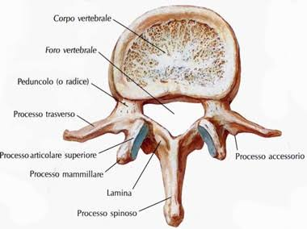
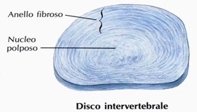

[TOC]

# ERGONOMIA
## La colonna vertebrale
### Ossa
Insieme anatomico costituito da elementi ossei, legamentosi e muscolari
- cervicale -> disco da 5mm
- toracica -> disco da 7mm
- lombare -> disco da 10 mm
in generale: STRUTTURA MOLTO FORTE
Il soma (zona centrale piu spessa, nella foto corpo vertebrale) è piu grande nella zona lombare che nella zona cervicale -> deve supportare più peso

### Altri componenti
- Disco intervertebrale
Composto da nucleo polposo e anelli fibrosi all'esterno 

- legamenti
diversi, come se la colonna fosse "fasciata"
- muscoli
in profondità piccoli muscoli che collegano una vertebra all'altra. Più esternamente muscoli erettori della spinale (lunghe fasce verticali)

---

## Lower back pain (LBP)
- **LBP** è sintomo, non malattia
    - diverse cause (postura, movimento, sport, affaticamento prolungato)
    - Aspecifico (senza causa)
- Molto comune
    - negli adulti ~37%
    - tra 9 e 18 anni ~40%
- Nella maggior parte dei casi non è grave (cause serie sono meno dell'1%)
- Multifattoriale
    - fattori biofisici, psicologici, sociali,
    - comportamento sedentario
    - obesità
    - anzianità (cambiamenti età-correlati) &rarr; degenerazione discale
    - secondo letteratura, in ambito sanitario c'è un aumento di rischio di LBP

---

## Cosa significa ergonomia
Dal latino **ergòn** (lavoro) e **nòrmos** (regole, norme)

Significa modificare elementi di un sistema (noi + ambiente) per migliorare la soddisfazione e ridurre rischio all'utente finale

### 3 livelli di ergonomia
1. **Analisi** degli effetti del lavoro (e strumenti) sull'uomo
2. **Progettazione** di situazioni e tecnologie &rarr; il contesto viene adattato all'operatore, non viceversa
3. **Prevenzione** &rarr; agire prima
---
## Termini utili
- **Forza di gravità**: è esercitata costantemente sul corpo. Si mantiene tono muscolare per contrastarla
- **Base d'appoggio**: area di superficie del terreno con cui il corpo entra in contatto
- **Centro di massa**: punto di equilibrio all'interno dell'oggetto
- **Centro di gravità**: proiezione sul terreno del centro di massa
- **Equilibrio**: centro di gravità all'interno dell'area di appoggio
---

## Strategie attuabili
Cosa possiamo fare nella pratica (in generale e in ambito socio-sanitario)

- Base d'appoggio ampia: più stabilità, evitare posizioni sfavorevoli
- Gambe: flettendo le gambe abbassiamo baricentro. Sfruttiamo la forza dei grandi muscoli delle gambe
- Peso del corpo: da usare come risorsa (sia il nostro che quello del paziente)
- Respirare durante gli sforzi (NO APNEA!!)
- Usare le capacità del paziente:
    - dare tempo
    - spiegare movimento all'utente
    - chiarire aspettative per la partecipazione attiva
    - rassicurare

    =>EMPOWERMENT DEL PAZIENTE

per quanto riguarda flettere la schiena sotto sforzo: la letteratura non evidenzia una differenza negli sforzi mondani tra presenza e assenza di flessione come causa di LBP