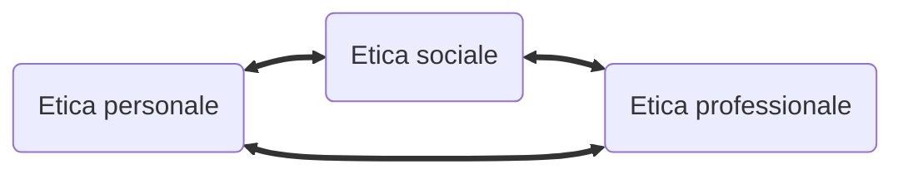
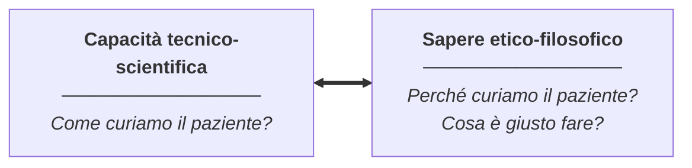
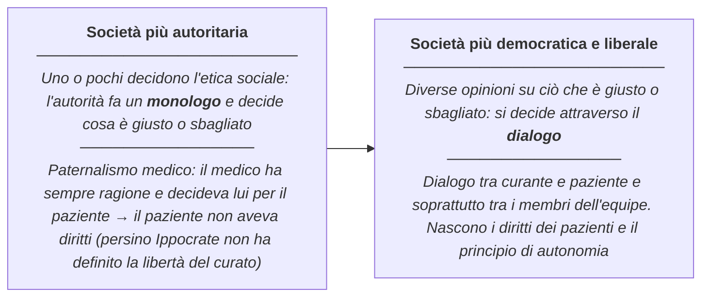
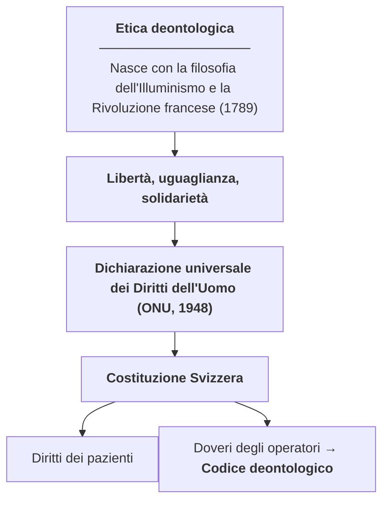

<h1 align="center">Etica</h1>

<em>MC anno 2026/2027</em>

[TOC]

# COS'È L'ETICA
Scienza che prova a rispondere alla domanda *"cosa è giusto e cosa è sbagliato?"*
Chiaramente non esiste una risposta oggettiva e assoluta &rarr; ci basiamo su diverse correnti e teorie

L'**etica** si rifà e deriva molto dalla **filosofia**: possiamo usare ==etica== e ==**filosofia morale**== in maniera intercambiabile
> L'etica è *la riflessione critica e razionale su ciò che è giusto e sbagliato, sui principi, sui valori e sulle norme di una determinata società o individuo*

> In breve: la filosofia/etica applicata ci serve come aiuto ad analizzare e risolvere problemi pratici (problemi etici)

## Problemi etici / morali
Esempi in ambito sanitario:
- **Eutanasia** (in Svizzera: qualsiasi gesto eseguito dai curanti che non è volto alla guarigione, ma che aiuta il paziente a morire)
- **Suicidio assistito**: è la persona stessa a compiere il gesto (Exit e simili: associazioni private senza scopo di lucro, per il bene del paziente)
- **Eutanasia attiva**: il medico/infermiere esegue un'iniezione letale (in CH ==illegale==; legale in Belgio, Olanda, Canada, ...)
- **Rianimazione** (REA o NO REA): si ragiona sulla qualità di vita del paziente dopo la rianimazione
- **Segreto professionale**: quando mantenerlo e quando no
- **Aborto**

Esempi più in generale: pena di morte, etica dell'IA, "esiste una guerra giusta?" (&rarr; leva obbligatoria e obiezione di coscienza)

&rArr; La risposta a questi temi cambia col punto di vista della ==società==. Il ruolo dell'etica non è dare risposte assolute, ma ==analizzare i vari punti di vista e le varie correnti di pensiero==

## Obiettivi e programma del corso
**Obiettivo principale**: acquisire le basi per lo studio futuro dell'etica in ambito sanitario
- conoscere principi, valori e norme alla base della società e delle professioni sanitarie
- saper analizzare casi pratici con concetti, teorie e modelli etici
- saper argomentare il proprio punto di vista su questioni professionali

Programma: **introduzione** (etica personale/sociale/professionale) &rarr; **teorie etiche** (deontologica, delle conseguenze, della cura) &rarr; **bioetica** (aborto, fecondazione assistita, eutanasia; sacralità vs qualità della vita)
> Come linee guida nazionali: Accademia Svizzera delle Scienze Mediche (**ASSM**)

# ETICA PERSONALE, SOCIALE E PROFESSIONALE

- **Etica personale**: cosa è giusto o sbagliato ==per me== (i miei principi e valori)
- **Etica sociale**: cosa è giusto o sbagliato ==per la società== &rarr; la **morale sociale**: l'insieme di principi, valori e norme di una società
    - Norme ==scritte== &rarr; le leggi (non uccidere, non rubare, non fare violenza)
    - Norme ==non scritte== &rarr; abitudini e consuetudini sociali
    - La morale ==limita la libertà degli individui== per garantire l'**ordine sociale** &rarr; lo scopo è la ==sopravvivenza== della società (pace/sicurezza sociale)
- **Etica professionale**: cosa è giusto o sbagliato ==nella mia professione== (principi, valori e norme della professione)

I tre livelli interagiscono e si influenzano. Quando etica personale ed etica professionale entrano in conflitto si parla di **obiezione di coscienza** &rarr; che si interfaccia spesso col principio di **non discriminazione** (es: non assumere un'infermiera cattolica perché contraria all'aborto = discriminazione)

Nell'etica professionale c'è una differenza tra i due saperi, che si completano a vicenda:

## Caso: interruzione di gravidanza
>Una ragazza di 20 anni, studentessa, scopre di essere incinta alla sesta settimana. Col ragazzo (22, studente, relazione da tre mesi) hanno sempre usato le precauzioni, ma qualcosa è andato storto. Non sa se abortire o no e si rivolge a un OS per una consulenza.

- **Etica personale** &rarr; il ragionamento che farà la ragazza per la propria salute e il proprio futuro
- **Etica sociale** &rarr; l'aborto è permesso per legge in Svizzera, quindi l'etica sociale lo permette
- **Etica professionale** &rarr; richiede ==oggettività==: l'OS deve solo permettere alla ragazza di fare una ==scelta informata== (non può scegliere per lei). ==La libertà di scelta del paziente è un diritto==

Concetti chiave che escono dal caso:
- **Principio di autonomia / autodeterminazione** &rarr; capacità del paziente di riflettere e decidere cosa è giusto per sé
- Per restare oggettivi in etica: dare ragioni ==a favore e contro== &rarr; assicurare imparzialità
- **Consenso libero e informato**: il paziente firma sempre &rarr; indica l'oggettività della consulenza e la libera scelta (si prende la sua responsabilità individuale)

## Analisi di casi pratici
Schema in 5 passi usato in classe:
1. Individua il problema etico
2. Giudizio individuale immediato
3. Giustifica il giudizio
4. Confronta la propria posizione con gli altri
5. Prova a trovare una soluzione condivisa (valutando gli altri punti di vista)

### La sonda alimentare
>In casa anziani, paziente con demenza in fase avanzata non mangia più. Sarebbe necessario un sondino PEG per la nutrizione artificiale. Non tutti i curanti sono d'accordo.

- *Sapere tecnico-scientifico*: come funziona una sonda PEG? Quali sono i rischi?
- *Sapere etico-filosofico*: è giusto nutrire artificialmente? È ciò che vorrebbe il paziente?

### Anna e Monica
>Anna è in stage in chirurgia. Le norme igieniche sono particolarmente severe per i pazienti ==MRSA positivi==, che devono restare in isolamento. Anna si stupisce quando scopre che a Monica — appena amputata di un alluce per una ferita infetta — è concesso, rispettando le precauzioni (disinfezione mani, camice pulito, ferita bendata), di passeggiare nel reparto. Il "privilegio" serve a evitare che l'isolamento aggravi la ==depressione== di cui Monica soffre.

1. **Problema etico**: contrapposizione tra isolamento per prevenire contagi (indiretti) e isolamento come aggravante della depressione (già presente)
2. **Giudizio immediato**: prima di concedere il privilegio sono state applicate diverse misure preventive, perciò è lecito lasciar passeggiare Monica
3. **Giustificazione**: quando ci prendiamo a carico il paziente non prendiamo a carico solo la malattia (l'alluce infetto), ma ==tutta la persona==. Data la correlazione tra salute fisica e mentale, date le precauzioni prese, è corretto permettere a Monica di passeggiare: un piccolo gesto per noi che aiuta molto la paziente

### Gli altri casi visti in classe
- **Chiara e Camilla**: in casa anziani gli ospiti vengono ==legati alla sedia== durante i pasti per evitare cadute; Camilla (82, instabile sulle gambe ma lucida) chiede di essere "liberata dal guinzaglio" &rarr; contenzione/sicurezza vs libertà e dignità della persona
- **Marco e Renzo**: Renzo ha un tumore al pancreas in stadio avanzato ma ==non conosce la diagnosi== (i figli hanno chiesto di non dirgliela); chiede a Marco "Ce la farò, vero?" &rarr; verità al paziente e autonomia vs protezione dal dolore
- **Piero e Sara**: Sara (sclerosi multipla + anoressia) rifiuta spesso il cibo; a Piero viene chiesto di collaborare a una somministrazione contro la sua volontà &rarr; beneficenza vs autodeterminazione

# TEORIE ETICHE
Una **teoria etica** è un modello di pensiero che ci può dire cosa è giusto o sbagliato, e come comportarci, in determinati casi, a partire da un certo punto di vista

Le tre teorie del corso: ==**Etica Deontologica**== · ==**Etica delle Conseguenze**== · ==**Etica della Cura**==

## Etica deontologica
Dal greco *Deon* &rarr; **dovere**. Logica di base: ==i miei diritti sono rispettati dai doveri altrui, e viceversa== &rarr; voglio che i diritti valgano per tutti, così ho la garanzia che valgano anche per me (e si evitano abusi di potere)

**Genealogia** — da dove arriva:

**Diritti e doveri** — due facce dell'uguaglianza dei diritti fondamentali:
- **Diritti**: alla vita, libertà di parola, espressione, credenza &rarr; per i curati: ==diritto alla cura e alla salute== in quanto persona
- **Doveri**: non uccidere, rispettare, tollerare &rarr; per i curanti: ==dovere di curare tutti i pazienti==, secondo **uguaglianza** e **non discriminazione**
    - *Vogliamo vivere in una società dove gli operatori sanitari scelgono chi curare e chi no?* &rarr; nessuno può decidere chi può essere curato e chi no

**Principi chiave**:
- I principi sono ==assoluti==: vanno rispettati sempre, ==indipendentemente dalle conseguenze== &rarr; rispetto ai principi assoluti, ==il fine non giustifica mai i mezzi==
- **Ultima ratio**: una misura che va contro un diritto fondamentale è ammessa solo come ultimissima risorsa (es. contenzione, trattamento senza consenso, violazione del segreto professionale &rarr; solo in casi eccezionali)
- **Criterio di proporzionalità**: la misura che va contro il diritto deve essere la ==meno invasiva possibile==
- Principi ideali (obiettivi a cui tendere): **integrità fisica** (non fare violenza fisica) e **integrità psichica** (non fare violenza psichica)

**Estratto della Costituzione Svizzera** (capitolo "Diritti fondamentali") — gli articoli chiave:
- Art. 7 — la ==dignità umana== va rispettata e protetta
- Art. 8 — ==uguaglianza giuridica==: nessuno può essere discriminato (origine, sesso, età, lingua, posizione sociale, convinzioni, disabilità, ...)
- Art. 10 — ==diritto alla vita== (pena di morte vietata) e alla ==libertà personale== (integrità fisica e psichica); tortura vietata
- Art. 11 — protezione di fanciulli e adolescenti
- Art. 12 — diritto all'==aiuto in situazioni di bisogno== (esistenza dignitosa)
- Art. 13 — protezione della ==sfera privata==
- Art. 15 — libertà di ==credo e coscienza==

**Etica deontologica ed etica professionale**: sta a fondamento dei **diritti dei pazienti** e del **codice deontologico** — regole, norme e doveri che l'operatore deve sempre seguire:
- dovere di curare ogni paziente ==in quanto persona==
- parità di trattamento e ==non discriminazione==
- rispetto della ==libertà di scelta informata== e dell'autonomia (se il paziente non è capace di discernimento: rappresentante legale e **volontà presunta**)

**I codici deontologici** (cure infermieristiche, ergoterapia, fisioterapia): principi comuni &rarr; rispetto della persona, della sua **autonomia** e **dignità**; informazione comprensibile e **consenso**; promozione/mantenimento dell'autonomia del paziente; **segreto professionale** e protezione dei dati

## Etica delle conseguenze
*(in corso a lezione — da integrare con quanto diremo in classe)*

A differenza della deontologica, ==non ci sono principi, valori o norme assolute== da rispettare sempre: ciò che conta sono le **conseguenze delle azioni**
- Un'azione è giusta o sbagliata ==in base ai suoi effetti== positivi e negativi sulle persone coinvolte &rarr; vanno valutati, calcolati e **bilanciati**
- In questa filosofia ==il fine può giustificare i mezzi== (nella deontologica mai)

### Utilitarismo
La principale etica delle conseguenze (**J. Bentham e J.S. Mill**):
- si stabilisce cosa è bene per tutti, un valore condiviso: il ==piacere, il benessere, la felicità== (a seconda delle versioni)
- azione **giusta** = produce più piacere/benessere/felicità ==per la maggioranza== delle persone coinvolte
- azione **sbagliata** = produce più dispiacere/malessere/sofferenza (o fa il bene solo mio a scapito degli altri)
> *"...più le persone intorno a me stanno bene, sono felici, più starò bene anche io..."* &rarr; se non riusciamo a fare il bene di tutti, almeno della maggioranza

Esempi di ragionamento consequenzialista:
- **Uccidere?** Di norma no (sofferenza per la persona, i cari, la società; "bene" solo per l'assassino) — ma uccidere un tiranno ==può essere lecito== se migliora il benessere di un popolo (es. discussioni su Saddam Hussein, Bin Laden) &rarr; valutando sempre *tutte* le conseguenze
- **Rubare?** Di norma no — ma rubare 1 miliardo a Jeff Bezos per darlo in beneficenza? Per il consequenzialismo può essere giusto; per la deontologica solo come *ultima ratio*. Rischio: se tutti rubassero ai ricchi &rarr; caos e abusi
- **Mentire?** "Cristina vuole uccidere Maria e ti chiede dove si trova": per le conseguenze, mentire qui è giusto
- **Responsabilità e intenzione**: investire un pedone non visto a 50 km/h &rarr; distinzione tra ==doloso== (intenzionale) e ==colposo== (non intenzionale)

### Applicazione all'etica professionale
Riferimento alla definizione di salute dell'**OMS (1948)**: *"stato di completo benessere fisico, psichico e sociale e non semplice assenza di malattia"*
- scopo dell'operatore: **fare il bene** (promuovere benessere e salute) e **contrastare il male** (malessere e malattia), del singolo e di tutti i pazienti di cui è responsabile
- da valutare: ==costi/benefici==, maleficenza/beneficenza, per il singolo e per la collettività

### Deontologica + Conseguenze insieme
| **Etica deontologica** | **Etica delle conseguenze** |
|---|---|
| Diritti e doveri fondamentali | Fare il bene: benessere, salute |
| Principi ==assoluti== | Contrastare il male: malessere, malattia |
| Ultima ratio, proporzionalità | ==Valutare e calcolare== le conseguenze |
| Diritti dei pazienti, codice deontologico | Azione giusta = + benessere, + salute |
| Libertà, autonomia, uguaglianza, dignità, integrità | Per tutti o per la maggioranza |
| Il fine ==non giustifica mai== i mezzi | Il fine ==può giustificare== i mezzi |
| Responsabili di ==rispettare i principi== | Responsabili delle ==conseguenze== delle azioni |

> Nella maggioranza dei casi vanno ==applicate insieme==: rispettare i principi primi e i diritti dei pazienti, *e* valutare le conseguenze in termini di benessere/malessere per paziente e collettività

## Etica della cura
**"Cura"** ha più significati: sollecitudine, dedizione, attenzione, assistenza / terapia per guarire una malattia. Qui si intende il ==prendersi cura== degli altri (e di sé)
> In inglese: **cure** (curare, terapia medica) vs **care** (prendersi cura, dedicarsi a qualcuno)

È un'etica della vita e delle ==relazioni==, che può essere anche etica professionale. Riferimenti: **C. Gilligan** (*Con voce di donna*, 1982), esistenzialismo e fenomenologia (Heidegger, E. Stein)

I fondamenti:
1. **Una "voce femminile" dell'etica**: storicamente la cura è stata compiuta dalle donne (madri, infermiere) nel privato, mentre gli uomini dibattevano nel pubblico &rarr; risposta alle relazioni ==uniche e individuali== dimenticate dalle "etiche maschili" (deontologica e conseguenze)
2. **L'essere umano è fragile**: più di ogni altra specie necessita della cura degli altri per sopravvivere, dalla nascita in poi — e può sempre ==ricadere nella dipendenza== (incidenti, malattie, invecchiamento)
3. **Esistere = essere in relazione**: diventiamo qualcuno a partire da relazioni di dipendenza, educazione e cura &rarr; ==siamo tutti potenzialmente a rischio di avere bisogno di cure==: ci si aiuta per solidarietà *e perché un giorno toccherà anche a me*
4. **Comprensione empatica**: capire il vissuto e i bisogni dell'altro ==proiettandosi in lui== (come la madre col bambino che piange) &rarr; l'empatia permette di capire anche chi non riesce a esprimersi a parole
5. **Cura autentica vs inautentica**:
    - ==inautentica== &rarr; "assistenzialista"/"maternalista": rende l'altro dipendente da me (non taglia il cordone ombelicale)
    - ==autentica== &rarr; parte dalla dipendenza ma ha come scopo l'**autonomia**: *"curare affinché l'altro sappia prendersi cura di sé"*

> **N.B.**: l'etica della cura non ci dice cosa è giusto o sbagliato fare, ma ==cosa bisognerebbe fare sempre e prima di tutto==: assistenza, dedizione, relazione, ascolto, empatia, comprensione dei bisogni

## Schema di analisi di un problema morale
1. Comprendere i ==vari punti di vista== delle persone coinvolte
2. Analizzare **pro e contro** applicando le teorie:

| PROBLEMA MORALE: ... | PRO | CONTRO |
|---|---|---|
| Etica deontologica | | |
| Etica delle conseguenze | | |

&nbsp;&nbsp;&nbsp;&nbsp;con l'**etica della cura** come base di partenza (ascolto, empatia, bisogni)

3. Trovare la ==soluzione migliore e più giusta==

Esempi di problemi da analizzare: "è giusto vietare il fumo?", "è giusto imporre le vaccinazioni?", "è giusto donare gli organi?"

# BIOETICA
*(ancora da trattare a lezione: aborto, fecondazione assistita, eutanasia; etica della Sacralità della Vita vs etica della Qualità della Vita)*
