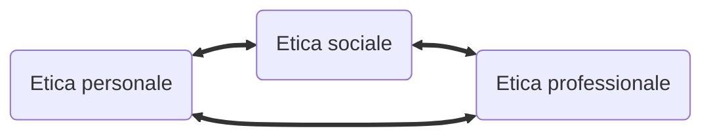
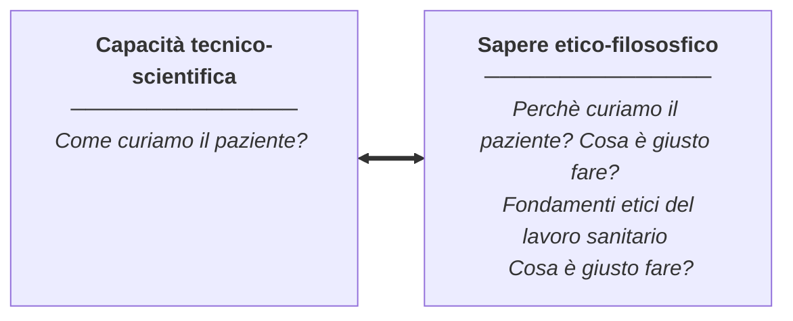
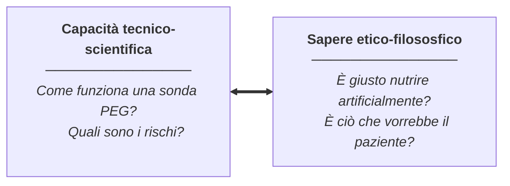
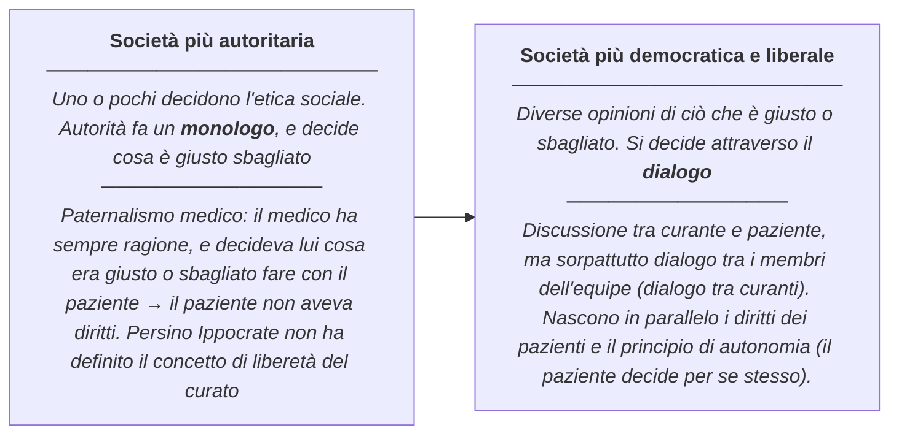
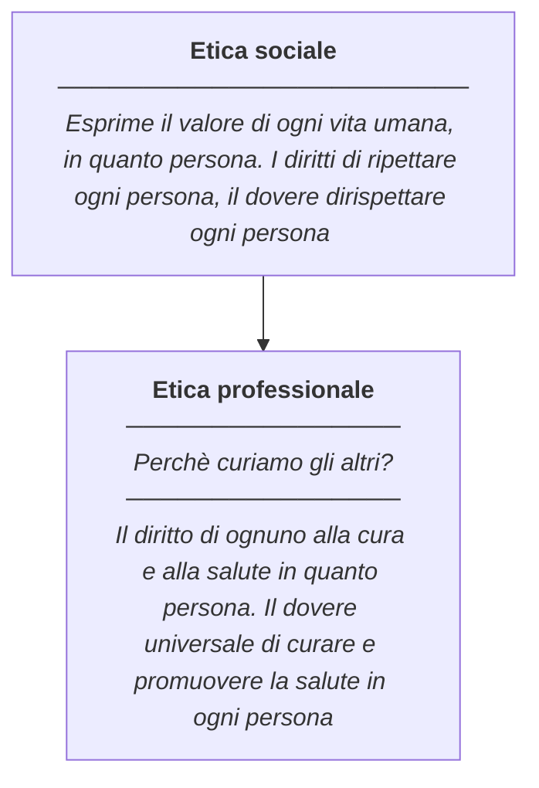
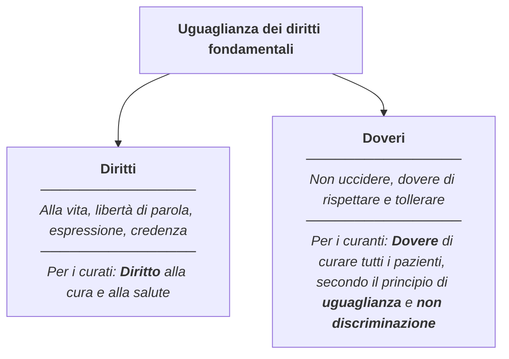
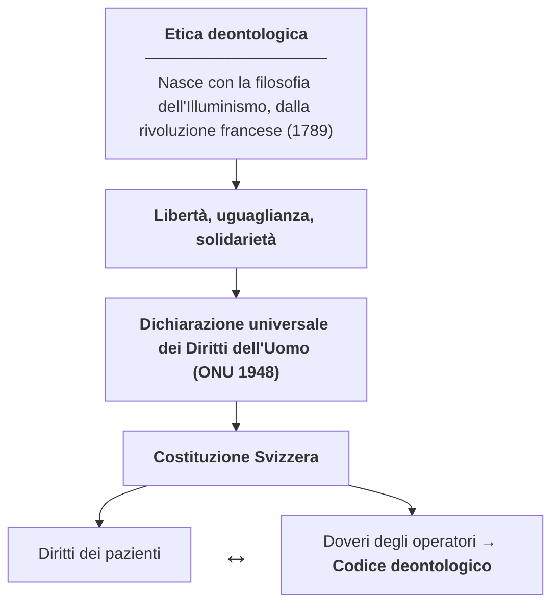
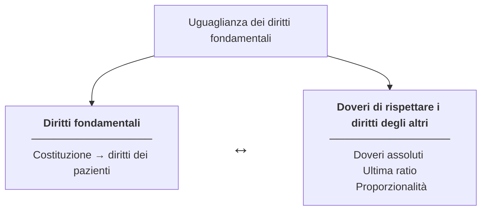

<h1 align="center">Etica</h1>

<em>MC anno 2026/2027</em>

[TOC]

# COS'È L'ETICA
Scienza che prova a rispondere alla domanda "cosa è giusto e cosa è sbagliato?"
Chiaramente non esiste una risposta oggettiva e assoluta &rarr; ci basiamo su diverse correnti e teorie

L'**etica** si rifà e deriva molto dalla **filosofia**. 

Più in particolare possiamo usare i termini ==etica== e ==**filosofia morale**== in maniera intercambiabile.

> In breve: filosofia/etica applicata ci serve come aiuto ad analizzare e risolvere problemi pratici (problemi etici)

## **Problemi etici / morali**
Esempi in ambito sanitario: 
- **Eutanasia** (In svizzera: qualsiasi gesto eseguito dai curanti che non è volto alla guarigione, ma che aiuta il paziente a morire)
- **Suicidio assistito**: In questo caso è la persona stessa a commettere il gesto (Exit e altre sono associazioni private senza scopo di lucro, che svolgono il servizio per motivi etici &rarr; per il bene del paziente)
- **Eutanasia attiva**: Situazione in cui il medico o infermiere esegue un iniezione letale (in CH ==illegale==, ma legale in Belgio, Olanda, Canada, ...)
- **Rinanimazione** del paziente (REA o NO REA). Si ragiona sulla qualità di vita del paziente dopo la rinanimazione
- **Segreto professionale**: banalmente, quando sono i casi in cui mantenere il segreto o quando no
- **Aborto**

Altri esempi più un generale:
- **Pena di morte**
- **Etica dell IA**
- **Esiste una guerra giusta?**: che si collega ai temi di leva obbligatoria e obbiezione di coscienza

=>La risposta a questi temi cambia rispetto al punto di vista della ==società==. Il ruolo dell'etica in tutto ciò non è dare risposte assolute a queste tematiche, ma anlizzare i vari punti di vista e le varie correnti di pensiero

## Obbiettivi del corso di etica
- Concoscere e saper riflettere sui principi, sui valori, sulle norme che stanno a fondamento della nostra società
- Conoscere e saper riflettere sui principi, sui valori, sulle norme che stanno a fondamento delle professioni sanitarie
- Saper riflettere sulla propria etica personale nei confronti delle professioni sanitarie
- Saper analizzare situazioni e casi pratici che sollevano interrogativi etici
- Conoscere, comprendere e saper spiegare concetti, teorie e modelli etici
- Saper applicare concetti, teorie e modelli etici alla pratica professionale, a situazioni e casi pratici
- Saper argomentare il proprio punto di vista su questioni professionali tramite concetti, teorie e modelli etici

=> **OBBIETTIVO PRINCIPALE**: acquisire basi per lo studio futuro dell'etica in ambito sanitario

## Sintesi del programma
- **Introduzione generale** all'etica: etica personale, etica sociale ed etica professionale (analisi di casi pratici)
- **Teorie etiche**:
    - **Etica Deontologica**, diritti dei pazienti, doveri dei curanti, codici deontologici, e applicare a casi pratici
    - **Etica delle conseguenze**: fare il bene del paziente, promozione del benessere e della salute, e applicazione a casi pratici
    - **Etica della cura**: ascolto dei bisogni del paziente, empatia, solidarietà, e applicazioni a casi pratici
- **Bioetica**: questioni bioetice (aborto, fecondazione assistita, eutanasia, ecc), etica della Sacralità della Vita ed Etica della Qualità della Vita, e analisi di casi pratici

>Come linee guida: Associazione Svizzera Scienze Mediche (ASSM) &rarr; linee guida nazionali

---
# INTRODUZIONE ALL'ETICA

- **Etica Personale**: cosa è giusto o sbagliato per me (quali sono i miei principi e i miei valori)
- **Etica Sociale**: cosa è giusto o sbagliato per la società (quali sono i principi, i valori e le norme della società &rarr; la legge)
- **Etica Professionale**: cosa è giusto o sbagliato nella mia professione (quali sono i principi, valori, e norme della mia professione) 

Questi tre elementi interagiscono, si relazionano, e si influenzano

## Caso: interruzione di gravidanza
>Una ragazza di 20 anni che sta frequentando una scuola univeritaria professionale scopre di essere incinta alla sesta settimana di gravidanza
Con il suo ragazzo di 22, anche lui studente e con il quale ha una relazione da tre mesi, hanno sempre usato le dovute precauzioni, ma qualcosa è andato storto
La ragazza non sa se abortire o no.
Si rivolge a un OS per una consulenza.
- **Qual'è l'ambito dell'Etica personale?** Ovvero il ragionamento che farà la ragazza per la propria salute e per il proprio futuro
- **Qual'è l'ambito dell'Etica sociale?** In breve, aborto permesso per legge in Svizzera, quindi l'etica sociale lo permette
- **Qual'è l'amito dell'Etica professionale?** Richiede ==oggettività==. Da parte dell'OS è richiesto solo di permettere alla ragazza di fare una scelta informata (ovviamente non puo scegliere l'OS per lei). È sempre il paziente a decidere &rarr; ==La libertà di scelta del paziente è un diritto==.
Si parla di **principio di autonomia/autodeterminazione** &rarr; capacità del paziente di riflettere e decidere cosa è giusto o sbagliato per se stesso

Come si fa a rimanere oggettivi in etica? Diamo ragioni a favore e contro &rarr; l'obbiettivo è assicurare imparzialità

Il paziente firma sempre il **consenso libero e informato**. Sta proprio a indicare l'oggettività della consulenza e la libera scelta &rarr; il paziente si prende la sua responsabilità individuale

Nel caso incontriamo un conflitto tra etica personale e etica professionale parliamo di **obiezione di coscienza**

Il diritto all'**obiezione di coscienza** si interfaccia spesso con il pricipio di **discriminazione** (es: se non assumo una infermiera cattolica perche contraria all'aborto sto discriminando)

## La morale sociale 
L'insieme di principi, valori e norme di una società che stabiliscono cosa é giusto e cosa é sbagliato

- Norme ==scritte== &rarr; leggi.
    Norme fondamentali: Non uccidere, non rubare, non fare violenza
- Norme ==non scritte== &rarr; abitudini, consuetudini sociali

==La libertà degli individui viene limitata dalla **morale**== vigente nella società, perchè se non ci fosse la società sprofonderebbe nel caos &rarr; lo scopo è la ==**sopravvivenza**==

Obbiettivo della morale è la **pace sociale** o **sicurezza sociale** &rarr; garantire l'**ordine sociale**

La riflessione qui é capire quali principi fondamentali devono essere scritti nella Costituzione

### L'etica è la filosofia morale
Se la **morale** è l'insieme di principi, valori e norme di una determinata società, allora l'**Etica** é ... 
&rarr; *la riflessione critica e razionale su ciò che è giusto e sbagliato, sui principi, sui valori e sulle norme di una determinata società o individuo*

## L'etica professionale

Vi è una differenza tra sapere tecnico-scientifico e sapere etico filosofico

### Casi pratici
#### La sonda alimentare

In casa anziani paziente con demenza in fase avanzata non mangia più. Sarebbe necessario un sondino PEG per nutrizione artificiale. Non tutti i curanti sono d'accordo

#### Anna e Monica

1. Individua il probelma etico
Chiaramente il problema in questione è la contrapposizione del concetto di isolamento per prevenire contatti indiretti e isolamento come causa di depressione (gia presente)

2. Giudizio individuale immediato:
Sembrerebbe che prima di concedere questo privilegio, siano state applicate diverse misure di protezione preventive, perciò direi che è lecito lasciar passeggiare Monica.

3. Giustifica
Quando ci prendiamo a carico il paziente non prendiamo a carico solo la malattia (in questo caso alluce infetto), ma tutta la persona. Data la correlazione che intercorre tra salute fisica e salute mentale, mi sembra corretto permettere a Monica, date le precauzioni prese, di poter passeggiare per il corridoio. in sintsi è un piccolo gesto per noi che però aiuta molto la paziente 

4. Confronta la propria posizione con gli altri

5. Provate a trovare una soluzione condivisa
    - valutare gli altri punti di vista
    - cosa fareste concretamente a risolvere il problema da stagista

# TEORIE ETICHE

una **teoria etica** è un modello di pensiero che ci può dire cosa è giusto o sbagliato. e come comportarci, in determinati casi a partire da un certo punto di vista

## Etica deontologica

Dal greco *Deon* &rarr; Dovere. In breve: I miei diritti sono rispettati dai doveri altrui, e viceversa

logica di base di questa teoria. Voglio che i diritti valgano per tutti, cosi ho la garanzia che valgano anche per me, e per evitare abusi di potere

Cambiamento nell'**etica sociale** &rarr; cambiamento nell'**etica professionale**

Secondo l'etica deontologica ci sono **principi**, **valori** e **doveri** che bisogna rispettare sempre e comunque. sono **assoluti**.
Questi principi, valori doveri assoluti devono valere sempre, **indipendetemente delle conseguenze** delle azioni, se non in casi del tutto eccezionali, come "**ultima ratio**". In caso di ultima ratio, la violazione dei principi, valori, doveri assoluti deve seguire il **criterio di proporzionalità**

### Esempio: Perchè uccidere è sbagliato?

- Diritto alla vita vale per tutti &rarr; uguaglianza dei diritti
  Dovere assoluto di non uccidere nessuno
- Le regole valgono per tutti, allora valgono anche per me
- *Volete vivere in una società dove uccidere è illegale?*
- Secondo l'etica deontologica introdotta da Kant, nessuno può decidere chi si meriti di vivere e chi no
- **Legittima difesa**? &rarr; concetto di *ultima ratio*: legittima difesa concessa quando è in pericolo la mia vita (non ho altra scelta, ultima spiaggia) &rarr; Principio della proporzionalità della forza

Il Concetto si riporta anche all'etica professionale sanitaria:
- diritto alla cura
- dovere di curare tutti per il criterio di non discriminazione
- *Vogliamo vivere in una società dove gli operatori sanitari scelgono chi curare e chi no?*
- nessuno puo decidere chi può essere curato e chi no

### Il Criterio di proporzionalità
La misura che va contro il diritto deontologico deve essere meno invasiva possibile

### Uguaglianza dei diritti fondamentali

- Principi ideali: obbiettivi a cui tendere
Tutto al fine di garantire:
- Integrità fisica (non fare violenza fisica)
- Integrità psichica (Non fare violenza psichica)

### Estratto della Costituzione Svizzera
Vedi file